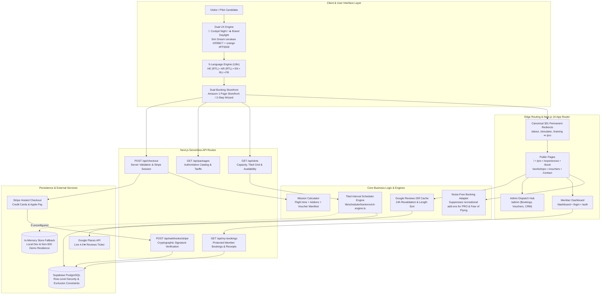
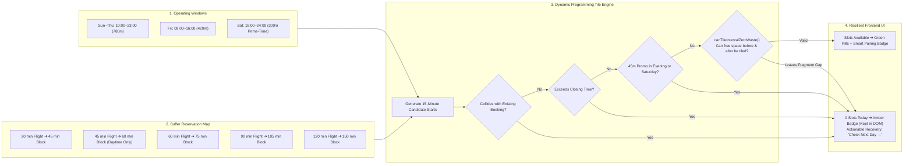
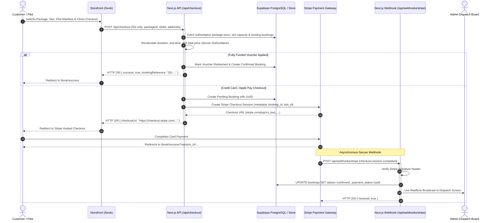
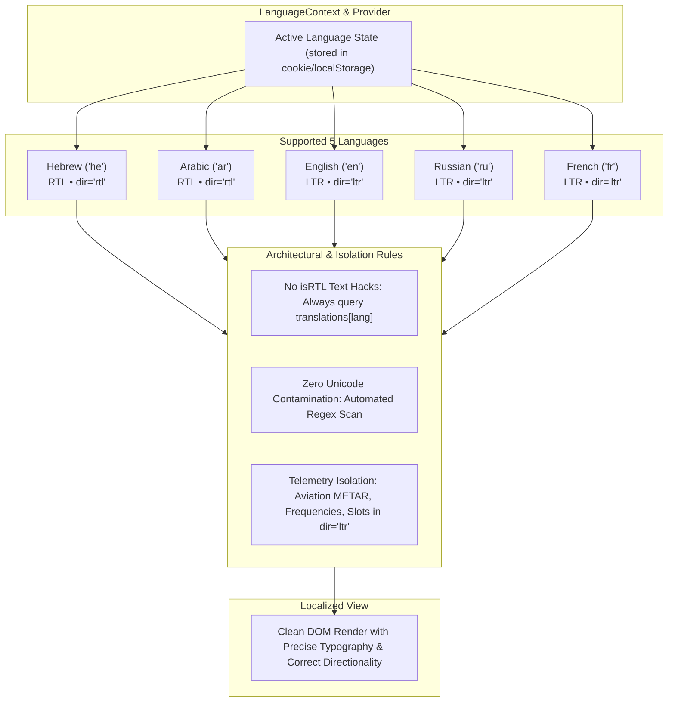

# SimDream LTD — Visual Architecture & System Design

Visual architecture documentation for **Sim Dream LTD** (`simdream.co.il`), Boeing 737 Flight Simulation Center, Tel Aviv.

---

## 1. High-Level System Architecture



---

## 2. Adaptive Booking Engine Architecture (Recreational vs Noise-Free PRO)

```mermaid
flowchart TD
    Start(["User Lands on Booking Engine (/book)"]) --> DetectPackage{"Package Category Check"}

    subgraph NoiseFreeFlow["Noise-Free 2-Step Flow (PRO & Fear of Flying)"]
        DetectPackage -->|category = 'training' (PRO)| ProConfig["Auto-Select: PRO Tiers (60/90/120 PRO)<br/>Pilot Level: ATPL"]
        DetectPackage -->|category = 'fear_of_flying'| FearConfig["Auto-Select: Fear of Flying Course<br/>Pilot Level: Beginner"]
        ProConfig --> Step1Pro["Step 1: Date & Operational Slot Selection"]
        FearConfig --> Step1Pro
        Step1Pro --> SuppressAddons["Step 2 Suppressed (Zero Recreational Add-ons)<br/>addons = []"]
        SuppressAddons --> Step3Pro["Step 2 (Direct): Pilot Manifest & Checkout"]
    end

    subgraph RecreationalFlow["Full 3-Step Storefront Flow (Recreational / Consumer)"]
        DetectPackage -->|category = 'recreational'| RecConfig["Display Full Catalog (20m, 45m, 60m, 90m)<br/>User Selects Pilot Level"]
        RecConfig --> Step1Rec["Step 1: Date & Slot Selection<br/>(Live Runway Capacity Bar)"]
        Step1Rec --> Step2Rec["Step 2: Cockpit Add-ons & Combos<br/>(Cold & Dark, 7 World Trios, 4K Video)"]
        Step2Rec --> Step3Rec["Step 3: Pilot Manifest & Checkout<br/>(Voucher Reapply & Manifest Summary)"]
    end

    Step3Pro --> SubmitCheckout(["POST /api/checkout"])
    Step3Rec --> SubmitCheckout
```

---

## 3. Kantorovich Tiled Interval Scheduler Architecture



---

## 4. Payment & Checkout Lifecycle Sequence Diagram


---

## 5. Bidirectional 5-Language Architecture (i18n)


