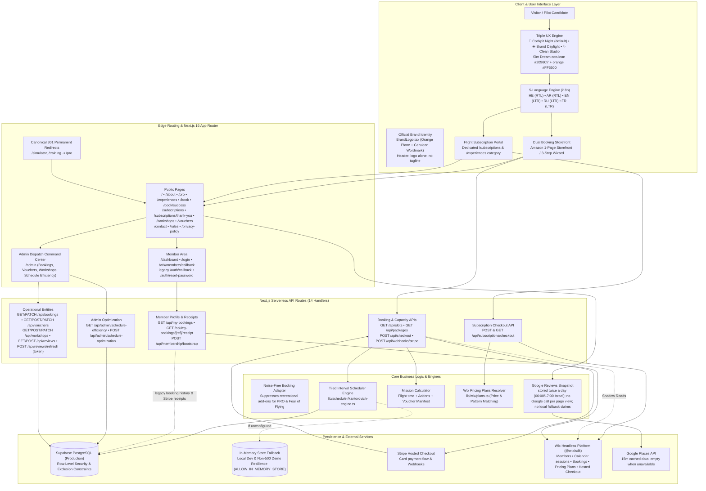
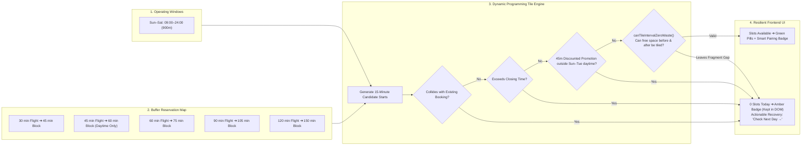
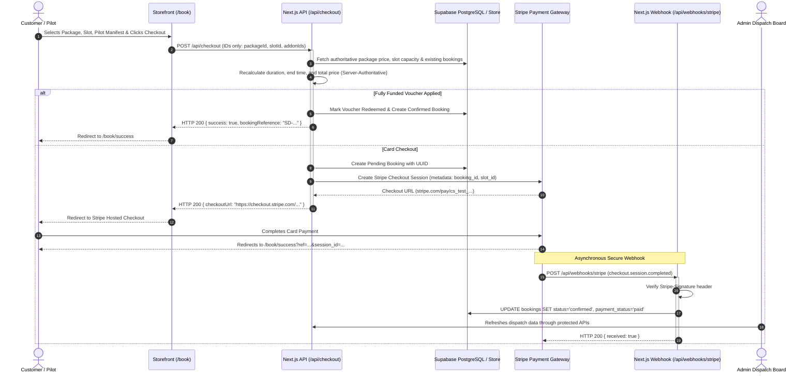
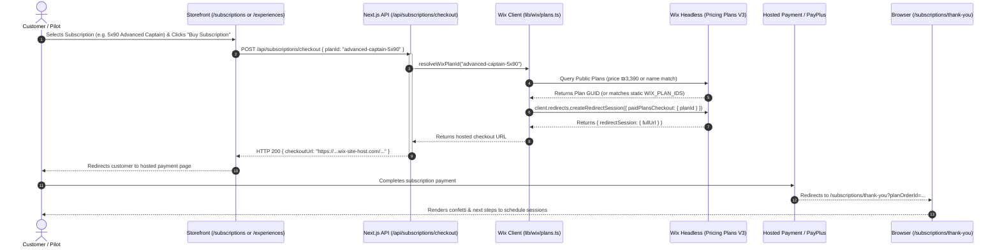
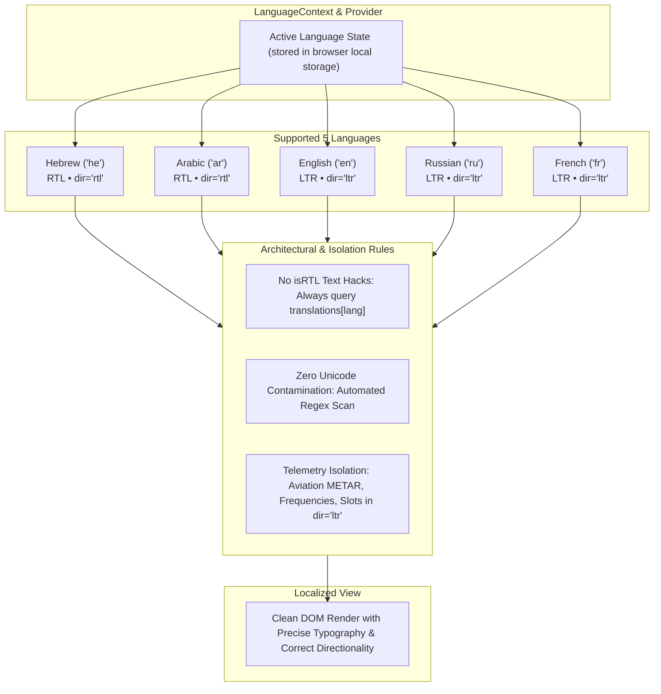
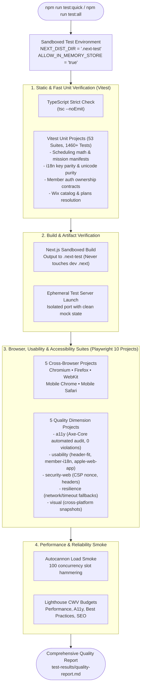

# SimDream LTD — Visual Architecture & System Design

Visual architecture documentation for **Sim Dream LTD** (`simdream.co.il`), Boeing 737 Flight Simulation Center, Tel Aviv.

---

## 1. High-Level System Architecture



### Checkout dependency boundary

`POST /api/checkout` remains a Next.js Route Handler. It calls the provider-neutral business service in `lib/booking/checkout-service.ts`, which receives only the checkout repository, hosted-card gateway, authenticated-member lookup, confirmation notifier, origin resolver, and clock ports from `lib/booking/checkout-ports.ts`. The server-only `lib/booking/checkout-composition.ts` currently binds those ports to Supabase, Stripe, SendGrid, and Supabase Auth; `checkout-runtime.ts` is the route-facing composition. This preserves the server-authoritative schedule, pricing, voucher, guest-checkout, and webhook rules while allowing a Wix staging adapter to be introduced without changing the customer UI or the checkout policy.

### Wix Member identity and Flight Deck boundary

Wix Members is the primary login for the managed frontend. `/login`, subscription purchase and the subscription panel share a PKCE launch routine in `lib/auth/auth-context.tsx`; the Wix-hosted page returns to `/wix/members/callback`, which stores a tab-scoped member session and refreshes the React profile. Guest checkout does not depend on this state.

For `/dashboard`, the browser sends its short-lived member access token to `GET /api/my-bookings`. `lib/auth/request-auth.ts` validates that token with Wix's current-member endpoint before `lib/wix/member-bookings.ts` queries Calendar using `memberId/me`. The result is a read-only Wix appointment projection: title, status, date, time and duration only. The UI deliberately hides price, invoice, Stripe receipt and local boarding-pass actions for it; Calendar is not payment proof. Active Pricing Plan orders remain in the shared `WixMemberSubscriptionPanel`; local Stripe receipts continue through the legacy verified Supabase ownership path.

### Wix P3 shadow-read boundary

When `WIX_SHADOW_READS_ENABLED=true`, a successful local booking initialization schedules a post-response diagnostic through Next.js `after()`. [`lib/wix/checkout-shadow.ts`](lib/wix/checkout-shadow.ts) queries only Wix Bookings' public service catalog and the mapped appointment service's availability for the already-selected local departure. It emits a redacted correlation event containing package/date/time, catalog-drift fields and match/mismatch status—never customer identity, voucher, booking-record, payment or card data.

The observer is strictly optional and non-blocking: disabled is the default; Wix failure is reduced to a diagnostic event; no Wix booking, checkout session, payment, member, voucher, coupon or CMS writer is reachable from the shadow interface. Supabase/Stripe remains the only checkout writer and Stripe's signed webhook remains the only card-payment authority. The documented Wix Bookings endpoints are paginated so a comparison never silently uses only a partial availability result.

### Wix Pricing Plans & flight subscriptions checkout boundary

Flight tracks are single-payment, 12-month commercial packages: four consumer tracks (`flight-foundations-5x60`, `advanced-captain-5x90`, `atpl-concepts-10x60`, `airline-readiness-10x90`, sold on `/subscriptions`) and two PRO tracks (`pro-interview-3x90`, `pro-interview-5x60`, sold on `/pro#pro-tracks` only). Checkout does not run through the one-off simulator slot booking engine:
1. `POST /api/subscriptions/checkout` receives the validated subscription pass ID.
2. `lib/wix/plans.ts` resolves the matching Wix Pricing Plan (checking `WIX_PLAN_IDS` environment overrides first, followed by dynamic scanning of live public plans by price and title pattern).
3. `createPlanCheckoutUrl()` calls `@wix/redirects` `client.redirects.createRedirectSession({ paidPlansCheckout: { planId } })` with `thankYouPageUrl: /subscriptions/thank-you` and `postFlowUrl: /subscriptions`.
4. If a plan is not yet published in Wix, the API gracefully falls back to Captain Dispatch (`/contact?subject=subscription&plan=...&notice=dispatch_assisted`) rather than failing closed with HTTP 500.

---

## 2. Adaptive Booking Engine Architecture (Recreational vs Noise-Free PRO vs Subscriptions)

```mermaid
flowchart TD
    Start(["User Lands on Booking Engine (/book) or Portal (/subscriptions)"]) --> DetectPackage{"Package Category Check"}

    subgraph NoiseFreeFlow["Noise-Free 2-Step Flow (PRO & Fear of Flying)"]
        DetectPackage -->|category = 'training' (PRO)| ProConfig["Auto-Select: PRO Tiers (60/90/120 PRO)<br/>Pilot Level: ATPL"]
        DetectPackage -->|category = 'fear_of_flying'| FearConfig["Auto-Select: Fear of Flying Course<br/>Pilot Level: Beginner"]
        ProConfig --> Step1Pro["Step 1: Date & Operational Slot Selection"]
        FearConfig --> Step1Pro
        Step1Pro --> SuppressAddons["Step 2 Suppressed (Zero Recreational Add-ons)<br/>addons = []"]
        SuppressAddons --> Step3Pro["Step 2 (Direct): Pilot Manifest & Checkout"]
    end

    subgraph RecreationalFlow["Full 3-Step Storefront Flow (Recreational / Consumer)"]
        DetectPackage -->|category = 'recreational'| RecConfig["Display Full Catalog (30m, 45m, 60m, 90m)<br/>User Selects Pilot Level"]
        RecConfig --> Step1Rec["Step 1: Date & Slot Selection<br/>(Live Runway Capacity Bar)"]
        Step1Rec --> Step2Rec["Step 2: Cockpit Add-ons & Combos<br/>(Cold & Dark, 7 World Trios, Extra Cockpit Guest)"]
        Step2Rec --> Step3Rec["Step 3: Pilot Manifest & Checkout<br/>(Voucher Reapply & Manifest Summary)"]
    end

    subgraph SubscriptionFlow["Single-Payment Annual Subscriptions Flow (/subscriptions)"]
        DetectPackage -->|category = 'subscriptions'| SubConfig["Display 4 Annual Tracks (5x60, 5x90, 10x60, 10x90)<br/>12-Month Validity • Active Captain Coaching"]
        SubConfig --> SubAction["User clicks 'Buy Subscription' / 'רכישת מנוי'"]
        SubAction --> SubCheckout(["POST /api/subscriptions/checkout"])
    end

    Step3Pro --> SubmitCheckout(["POST /api/checkout (Stripe)"])
    Step3Rec --> SubmitCheckout
    SubCheckout --> WixRedirectFlow(["Wix Pricing Plans Hosted Checkout (@wix/redirects)"])
```

---

## 3. Kantorovich Tiled Interval Scheduler Architecture



---

## 4. Payment & Checkout Lifecycle Sequence Diagram



### 4B. Wix Pricing Plans & Subscriptions Checkout Lifecycle Sequence Diagram


---

## 5. Bidirectional 5-Language Architecture (i18n)



---

## 6. Automated Quality Framework & Testing Pipeline (TESTING.md)


