# SimDream LTD — Visual Architecture & System Design

Visual architecture documentation for **Sim Dream LTD** (`simdream.co.il`), Boeing 737 Flight Simulation Center, Tel Aviv.

---

## 1. High-Level System Architecture

### 1A. Executive System Landscape (Human-Readable Overview)

A high-level view of how customers, flight candidates, instructors, and operational staff interact with the SimDream platform and its connected services:

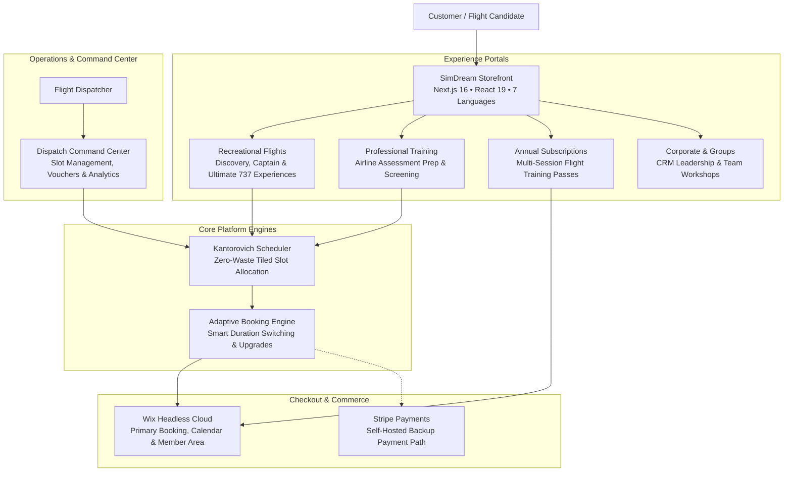

---

### 1B. System Topology & Component Graph (Professional Technical Deep-Dive)

The complete engineering topology mapping client UI layers, App Router pages, domain business logic, API route handlers, and backend persistence boundaries:

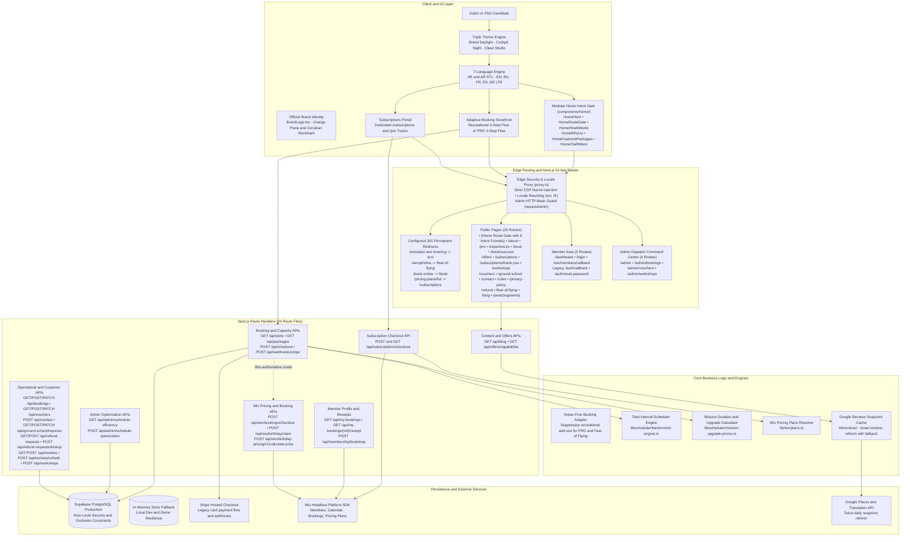

### Edge Security & Request Proxy boundary (`proxy.ts`)

Next.js 16 request routing, security enforcement, and locale handling are anchored in [`proxy.ts`](proxy.ts) at the repository root:
1. **Per-Request Content Security Policy (CSP)**: Generates a cryptographically strong UUID base64 nonce (`x-nonce`) for every HTML document request, binding `script-src 'self' 'nonce-{nonce}' 'strict-dynamic'` while allowing necessary image hosts (`lh3.googleusercontent.com`, `static.wixstatic.com`), connect hosts (`*.supabase.co`, `www.wixapis.com`, `edge.wixapis.com`), and Google Maps frames.
2. **Wix Multilingual Locale Routing**: Normalizes secondary locale URL paths (`/en/...`, `/fr/...`, etc.) to the internal Next.js route tree while setting the `x-simdream-locale` request header, isolating directionality and page state without duplicate routing trees.
3. **Admin Shell Protection**: Matches the `/admin` route family (`/admin`, `/admin/*`, `/admin.rsc`, and Next.js data routes) and enforces server-side HTTP Basic authentication via `requireAdmin(request)` before any page or handler evaluates.

### Checkout dependency boundary

`POST /api/checkout` is the legacy local Next.js checkout path. It calls the provider-neutral business service in `lib/booking/checkout-service.ts`, whose server composition binds Supabase, Stripe, SendGrid, and Supabase Auth. It preserves server-authoritative schedule, pricing, voucher, guest-checkout, and Stripe webhook rules. Outbound idempotent fetches enforce strict deadlines (`lib/http/timeouts.ts`: 5s member-token check, 8s Wix catalog/availability/calendar/Google, 20s availability query). `POST /api/checkout` overlaps member identity verification and voucher lookup with slot checking (preserving hold precedence and error priority), and dispatches voucher-funded confirmation emails as a post-response task via Next.js `after()` (`lib/booking/after-response.ts`). When `WIX_AVAILABILITY_ADAPTER_ENABLED=true`, that local writer refuses mapped base-flight checkout so that Wix-native browser checkout is the only writer for the same slot. The frontend's Wix path switches `/api/slots` to the upgraded duration's own schedule grid when a promotional tier bump-up activates (`resolveScheduleDurationMinutes()` + `SlotAdjustmentBanner`), revalidates the live slot (re-anchored around live bookings via `lib/wix/wix-blocked-bookings.ts` when the pricing provider is off, lengthening via `customerChoices.addOnIds` for duration add-ons, and surfacing `409`/`503` failures through `WixDraftPrepareError`), creates a Wix booking carrying native `bookedAddOns` (`lib/wix/native-addons.ts`), builds Cart V2 (skipping Wix Stores products for add-ons already booked natively; `WIX_ADDON_PRODUCT_IDS` remains a fallback for unmapped add-ons), calculates the cart, and opens Wix-hosted checkout. The repository proves this integration code and its flags—not that any external Wix payment/provider configuration is active.

### Wix Member identity and Flight Deck boundary

Wix Members is the primary login for the managed frontend. `/login`, subscription purchase and the subscription panel share a PKCE launch routine in `lib/auth/auth-context.tsx`; the Wix-hosted page returns to `/wix/members/callback`, which stores a tab-scoped member session and refreshes the React profile. Guest checkout does not depend on this state.

For `/dashboard`, the browser sends its short-lived member access token to `GET /api/my-bookings`. `lib/auth/request-auth.ts` validates that token with Wix's current-member endpoint before `lib/wix/member-bookings.ts` queries Calendar using `memberId/me`. The result is a read-only Wix appointment projection: title, status, date, time and duration only. The UI deliberately hides price, invoice, Stripe receipt and local boarding-pass actions for it; Calendar is not payment proof. Active Pricing Plan orders remain in the shared `WixMemberSubscriptionPanel`; local Stripe receipts continue through the legacy verified Supabase ownership path.

### Wix availability and shadow-read boundaries

When `WIX_SHADOW_READS_ENABLED=true`, a successful local booking initialization schedules a post-response diagnostic through Next.js `after()`. [`lib/wix/checkout-shadow.ts`](lib/wix/checkout-shadow.ts) queries only Wix Bookings' public service catalog and the mapped appointment service's availability for the already-selected local departure. It emits a redacted correlation event containing package/date/time, catalog-drift fields and match/mismatch status—never customer identity, voucher, booking-record, payment or card data.

The observer is strictly optional and non-blocking: disabled is the default; Wix failure is reduced to a diagnostic event; no Wix booking, checkout session, payment, member, voucher, coupon or CMS writer is reachable from the shadow interface. This describes the shadow path only. With `WIX_AVAILABILITY_ADAPTER_ENABLED=true`, the separate Wix-authoritative browser flow is allowed to create the mapped Wix booking and Cart V2 checkout, while the local writer is blocked. Stripe's signed webhook remains the only payment authority for the local path. The documented Wix Bookings endpoints are paginated so a comparison never silently uses only a partial availability result.

### Wix Pricing Plans & flight subscriptions checkout boundary

Flight tracks are single-payment, 12-month commercial packages: four consumer tracks (`flight-foundations-5x60`, `advanced-captain-5x90`, `atpl-concepts-10x60`, `airline-readiness-10x90`, sold on `/subscriptions`) and two PRO tracks (`pro-interview-3x90`, `pro-interview-5x60`, sold on `/pro#pro-tracks` only). Checkout does not run through the one-off simulator slot booking engine:
1. `POST /api/subscriptions/checkout` receives the validated subscription pass ID.
2. `lib/wix/plans.ts` resolves the matching Wix Pricing Plan (checking the static `WIX_PLAN_IDS` map, populated by the six individual `WIX_PLAN_ID_*` environment variables, then dynamically scanning live public plans by price and title pattern).
3. `createPlanCheckoutUrl()` calls `@wix/redirects` `client.redirects.createRedirectSession({ paidPlansCheckout: { planId } })` with `thankYouPageUrl: /subscriptions/thank-you` and `postFlowUrl: /subscriptions`.
4. If a plan is not yet published in Wix, the API gracefully falls back to Captain Dispatch (`/contact?subject=subscription&plan=...&notice=dispatch_assisted`) rather than failing closed with HTTP 500.

---

## 2. Adaptive Booking Engine Architecture (Recreational vs Noise-Free PRO vs Subscriptions)

### 2A. The 3 Customer Booking Journeys (Human-Readable Overview)

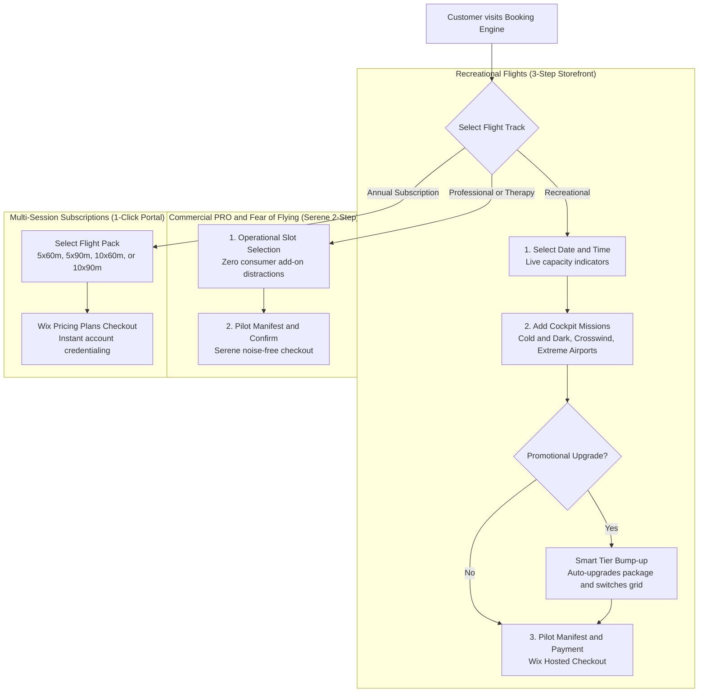

---

### 2B. Adaptive Booking Pipeline & Upgrade State Machine (Professional Deep-Dive)

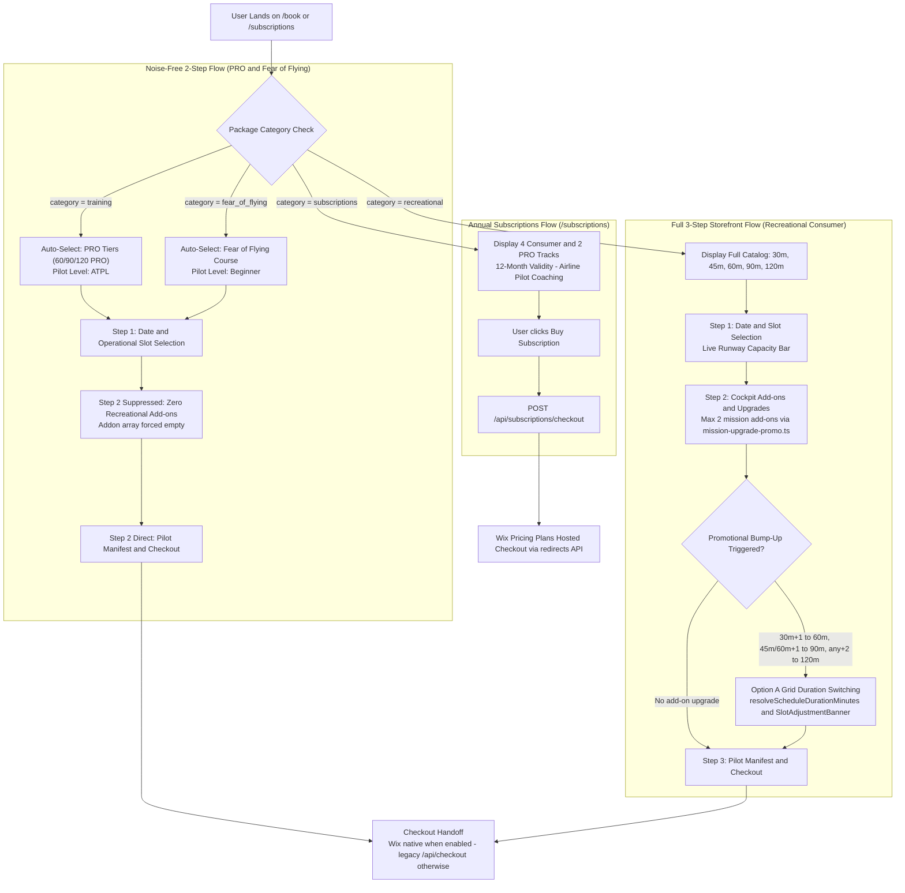

---

## 3. Kantorovich Tiled Interval Scheduler Architecture

### 3A. Zero-Waste Scheduling Principle (Human-Readable Overview)

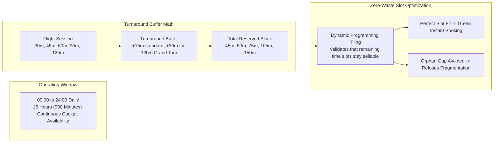

---

### 3B. Dynamic Programming Tiling Engine Pipeline (Professional Deep-Dive)

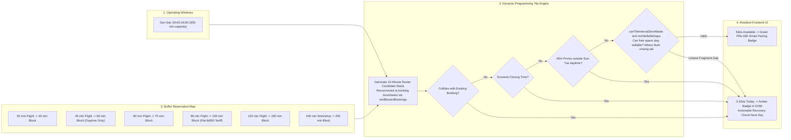

---

## 4. Payment & Checkout Lifecycle Sequence Diagrams

### 4A. Primary Wix Headless Checkout Flow (Sequence Diagram)

When `WIX_AVAILABILITY_ADAPTER_ENABLED=true` (the production-standard configuration), booking checkout delegates to Wix Bookings, native duration-extending add-ons, and Wix Hosted Checkout:

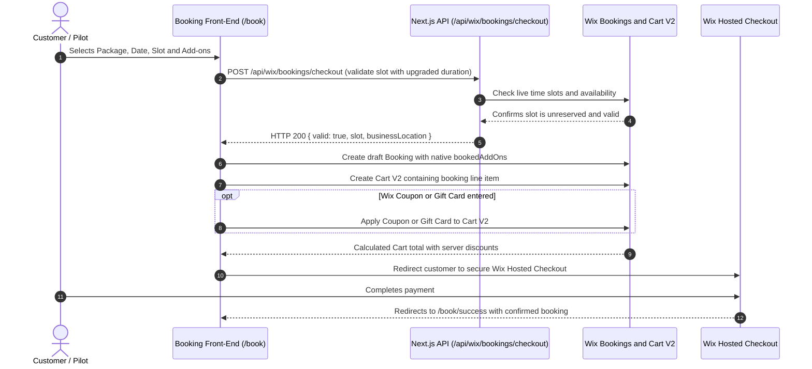

---

### 4B. Legacy Supabase / Stripe Checkout Flow (Sequence Diagram)

This fallback flow applies only while `WIX_AVAILABILITY_ADAPTER_ENABLED` is disabled. When Wix authority is enabled, the local `POST /api/checkout` writer returns `409` rather than creating a competing reservation:

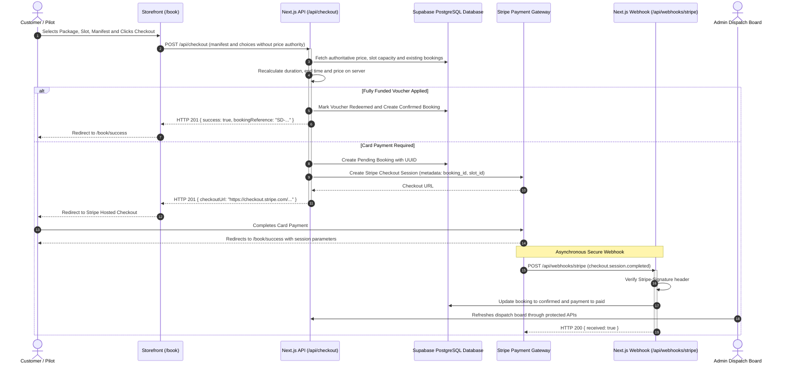

---

### 4C. Wix Pricing Plans & Subscriptions Checkout Flow (Sequence Diagram)

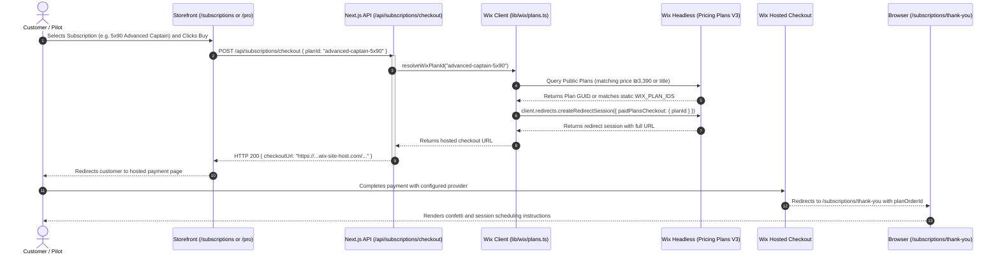

---

## 5. Bidirectional 7-Language Architecture (i18n)

### 5A. Multilingual User Experience (Human-Readable Overview)

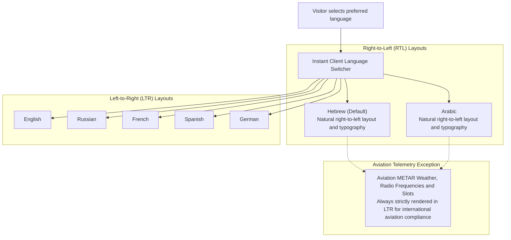

---

### 5B. Technical i18n Engine & Directionality Isolation (Professional Deep-Dive)

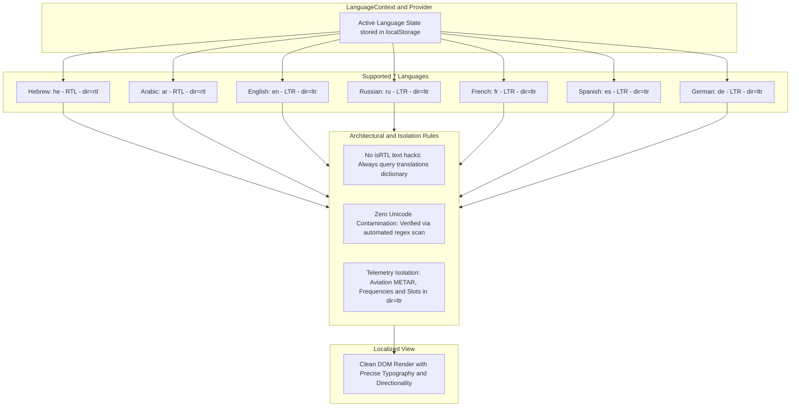

---

## 6. Automated Quality Framework & Testing Pipeline (TESTING.md)

### 6A. From Commit to Release Quality Gates (Human-Readable Overview)

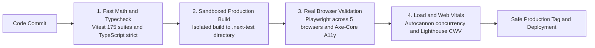

---

### 6B. Comprehensive Testing Topology (Professional Deep-Dive)

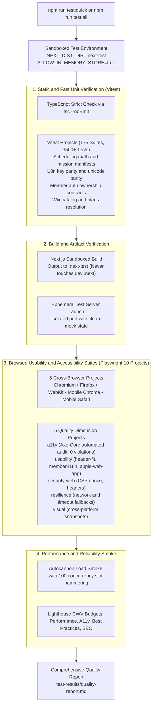
