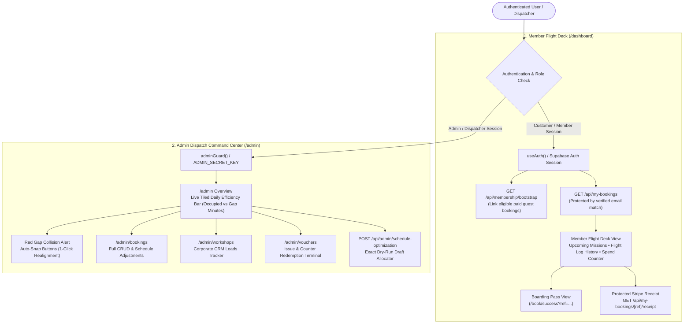

# SimDream Dashboard Reproduction Specification & AI Master Prompt

This specification is a comprehensive blueprint designed to enable **any autonomous AI agent or AI coding system** (such as Google Antigravity, Claude Code, Cursor, Devin, or OpenAI GPT-4/o1) to reproduce the **SimDream Dashboards** identically, with 100% architectural fidelity, security boundaries, and multilingual precision.

---

## Master AI Agent Prompt

> **Instructions for AI Agent**:
> You are tasked with implementing or reproducing the dual dashboard system for **Sim Dream LTD** (`simdream.co.il`), a Boeing 737 Flight Simulation Center in Tel Aviv.
> The system consists of two distinct dashboards:
> 1. **Member Flight Deck (`/dashboard`)**: Customer-facing portal for authenticated flight simulator pilots to track their upcoming missions, historical flight logs, total flight spend, boarding passes, and protected Stripe receipts.
> 2. **Admin Dispatch Command Center (`/admin`)**: Operations portal for flight dispatchers and administrators to monitor daily tiled simulator efficiency (occupied vs wasted tail minutes), resolve orphan gap collisions via interactive 1-click Auto-Snap, manage reservations, track corporate CRM workshop leads, and redeem vouchers.
>
> Follow the exact architecture, data models, security invariants, dual-theme styling (Cockpit Night & Brand Daylight), and 5-language internationalization detailed below.

---

## 1. High-Level Dashboard Taxonomy & Topology



---

## 2. Member Flight Deck (`/dashboard`) Implementation Specification

### A. Route & Component Architecture
- **Layout**: [`app/dashboard/layout.tsx`](app/dashboard/layout.tsx)
  - Renders authenticated navigation shell with official logo ([`components/brand/BrandLogo.tsx`](components/brand/BrandLogo.tsx)).
  - Includes user greeting: `t.member.dashboard.welcomeBack`, user email pill, language switcher, theme toggle, and Sign Out button.
  - Redirects unauthenticated visitors to `/login` if auth is resolved and `user === null`.
- **Page Component**: [`app/dashboard/page.tsx`](app/dashboard/page.tsx)
  - Client component (`'use client'`).
  - Consumes `useAuth()` and `useLanguage()`.
  - Date filtering respects Israeli calendar time (`todayInIsrael()`, timezone: `Asia/Jerusalem`).

### B. Data Model & State Machine
```typescript
interface DashboardState {
  bookings: Booking[];
  loading: boolean;
  loadError: DashboardErrorKey | null;
  receiptError: DashboardErrorKey | null;
  openingReceipt: string | null; // booking reference being loaded
}

// Derived states via useMemo:
// 1. upcomingBookings: bookingDate >= todayInIsrael() && status !== 'cancelled' && status !== 'completed'
// 2. historyBookings: !upcoming && sorted descending by date/time
// 3. paidSpend: sum of totalIls for bookings where paymentStatus === 'paid'
```

### C. Security Invariants (Fail-Closed & Verified Identity)
1. **Verified Email Match Only**: A booking is returned from `GET /api/my-bookings` **only** if the booking's customer email matches the authenticated member's verified identity-provider email (`lib/auth/member-ownership.ts`).
2. **Anonymous Lookup Isolation**: Public `/book/success` only returns a narrow projection (flight date, slot time, package name, pilot name). Anonymous lookups cannot query history or Stripe receipts.
3. **Stripe Receipt Security**: `GET /api/my-bookings/[bookingReference]/receipt` requires a valid Supabase JWT Bearer token with a confirmed email matching the booking. If verified, it fetches `payment_intent` from Stripe and returns the hosted `receipt_url`.

### D. Localized Error Key Mapping
Errors from `/api/my-bookings` must be mapped to localization keys in `t.member.dashboard.errors` so that server English text never leaks to Hebrew, Arabic, Russian, or French users:

| Server Error Message | Localized Error Key |
| :--- | :--- |
| `Confirm your email address to access member purchases.` | `emailNotConfirmed` |
| `Authentication required.` | `authRequired` |
| `Booking data is temporarily unavailable.` | `bookingDataUnavailable` |
| `Authentication with a confirmed email is required.` | `receiptConfirmedEmailRequired` |
| `Booking not found.` | `bookingNotFound` |
| `A Stripe payment receipt is not available for this booking.` | `receiptNotAvailableForBooking` |
| `Payment receipt is temporarily unavailable.` | `receiptTemporarilyUnavailable` |
| `Stripe has not published a receipt for this payment yet.` | `receiptNotPublished` |

### E. Date Formatting Across 5 Languages
Use `DATE_LOCALES`:
- `en`: `'en-GB'` (day month year)
- `he`: `'he-IL'` (יום, תאריך עברי/לועזי)
- `ru`: `'ru-RU'`
- `fr`: `'fr-FR'`
- `ar`: `'ar-u-nu-latn'` (Arabic text with Latin telemetry digits)

---

## 3. Admin Dispatch Command Center (`/admin`) Implementation Specification

### A. Route Structure
- [`app/admin/layout.tsx`](app/admin/layout.tsx): Admin shell with dispatch header, live Israel clock, and tab links (`Overview`, `Bookings`, `Vouchers`, `Corporate Workshops`).
- [`app/admin/page.tsx`](app/admin/page.tsx): Main operational monitor and schedule efficiency hub.
- [`app/admin/bookings/page.tsx`](app/admin/bookings/page.tsx): Booking record table with search, status filters (`confirmed`, `pending`, `cancelled`), and rescheduling modal.
- [`app/admin/vouchers/page.tsx`](app/admin/vouchers/page.tsx): Counter voucher redemption terminal and gift code generator.
- [`app/admin/workshops/page.tsx`](app/admin/workshops/page.tsx): Corporate CRM leadership lead pipeline (status: `new`, `contacted`, `proposal_sent`, `booked`, `archived`).

### B. Daily Tiled Efficiency Bar & Metrics
The dispatcher selects an operational date (defaulting to tomorrow in Israel time). The view queries `GET /api/admin/schedule-efficiency?date=YYYY-MM-DD` and renders:
1. **Total Daily Capacity**:
   - Sun–Thu: `780 min` (`10:00–23:00`)
   - Fri: `420 min` (`09:00–16:00`)
   - Sat: `300 min` (`19:00–24:00` Prime-Time)
2. **Occupied Flight & Buffer Minutes**: Sum of `reservedMinutes` for confirmed flights.
3. **Orphan Gap Minutes ("Хвосты" / Wasted Runway Tail)**: Unusable gaps (< 45 min) between bookings or operating boundaries.
4. **Efficiency Percentage**: `(occupiedMinutes / totalCapacityMinutes) * 100`.
5. **Daily Revenue Metric**: Total revenue booked for that calendar date.

### C. Red Gap Collision Detection & Interactive Auto-Snap
When an admin shifts a booking or candidate to an unaligned start time (e.g. `19:00` on a 75-minute grid), the scheduler engine calculates if the surrounding space leaves an untileable gap:
- If `canTileIntervalZeroWaste()` returns `false`, the UI triggers a **Red Gap Collision Alert** (`bg-rose-500/10 border-rose-500`).
- The alert displays **Auto-Snap buttons** calculating the nearest valid 15-minute slot boundary (e.g., `[Auto-Snap to 18:00]` or `[Auto-Snap to 19:15]`).
- Clicking the Auto-Snap button calls `PATCH /api/bookings` with the snapped start time and refreshes the efficiency report with 0 wasted tail minutes.

### D. Exact Dry-Run Draft Allocator (`/api/admin/schedule-optimization`)
- **Boundary**: Protected, non-mutating preview (`POST /api/admin/schedule-optimization`).
- **Constraint**: Evaluates at most 8 draft requests against immutable existing bookings.
- **Rule**: Accepts a combination only if it maximizes declared value **without increasing baseline orphan capacity**.
- **Safety**: Never writes to the database; returns recommendations and audit metadata for dispatcher review.

---

## 4. Design System & Theme Styling Tokens

Both dashboards strictly implement the Sim Dream brand tokens and dual-theme engine:

| Element | Cockpit Night (`data-ui="cockpit"`) | Brand Daylight (`data-ui="brand"`) |
| :--- | :--- | :--- |
| **Page Surface** | Dark slate / titanium (`bg-slate-950`) | Crisp cloud white (`bg-slate-50`) |
| **Cards & Drawers** | Translucent slate glass (`bg-slate-900/80 border-slate-800`) | Clean white card (`bg-white border-slate-200 shadow-sm`) |
| **Primary Cerulean** | `#2096C7` (Tailwind `sky-500` accents) | `#2096C7` (Large text/accents; small text uses `sky-700` for 4.5:1 AA) |
| **Brand Orange** | `#FF5500` (Tailwind `orange-500`) | `#FF5500` (Logo & icons; small text uses `orange-700` for 5.3:1 AA) |
| **Telemetry Numbers** | Jet-black background with cyan HUD digits | Crisp dark slate monospace font |
| **Status Badges** | `sky`, `emerald`, `amber`, `slate` border pills | Matching high-contrast light theme pills |

---

## 5. 5-Language Translation Schema (`translations.ts`)

Every customer-facing string on the Member Flight Deck must be resolved via `useLanguage().t.member.dashboard`:

```typescript
// Required Keys for Member Dashboard across 'he' | 'en' | 'ru' | 'fr' | 'ar':
t.member.dashboard: {
  title: string;              // "Member Flight Deck" / "יומן טיסות חבר"
  welcomeBack: (name: string) => string;
  tabs: {
    upcoming: string;         // "Upcoming Missions"
    history: string;          // "Flight Log History"
  };
  stats: {
    totalFlights: string;     // "Missions Flown"
    totalSpend: string;       // "Total Flight Investment"
    nextMission: string;      // "Next Cleared Departure"
  };
  card: {
    boardingPassBtn: string;  // "View Boarding Pass ↗"
    stripeReceiptBtn: string; // "Stripe Receipt ↗"
    status: {
      confirmed: string;
      completed: string;
      paymentPending: string;
      cancelled: string;
      refunded: string;
    };
  };
  empty: {
    noUpcoming: string;       // "No upcoming missions scheduled."
    bookNextBtn: string;      // "Book Your Next Flight ✈"
    noHistory: string;        // "Your pilot logbook is currently empty."
  };
  errors: Record<DashboardErrorKey, string>;
}
```

---

## 6. Acceptance & Automated Verification Suite

To verify that an AI-generated dashboard matches the production standard, run:

```bash
# 1. Typecheck & Unit verification
npm run typecheck
npm run test:quick

# 2. Member Dashboard i18n & Usability audit across 5 languages
npx playwright test tests/usability/member-i18n.spec.ts

# 3. Accessibility audit (0 axe color-contrast violations baseline)
npx playwright test tests/a11y/a11y.spec.ts

# 4. Header & Navigation fit from 320px to 1920px
npx playwright test tests/usability/header-fit.spec.ts
```

