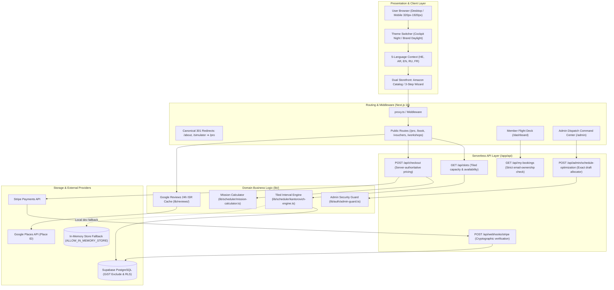

# Historical Genesis Draft

> **Status — superseded.** This first draft was written before the full source-led review and contains material inaccuracies: it says `/about` redirects to `/pro`, represents a 14-day calendar as default, and claims Apple Pay and PDF boarding-pass delivery. The current source does not implement those behaviors.
>
> Use [`WEBSITE_GENESIS.md`](WEBSITE_GENESIS.md) as the reviewed one-shot recreation prompt and read [`FULL_CODEBASE_REVIEW.md`](FULL_CODEBASE_REVIEW.md) first for scope, evidence, corrections, and production-readiness boundaries. This document remains only for historical traceability; it is **not** an authoritative implementation specification.

---

# Phase 1: Deep Codebase Analysis

### 1. Tech Stack & Dependencies

| Layer | Technology | Primary Function in Codebase |
| :--- | :--- | :--- |
| **Framework & Runtime** | **Next.js 16.4.2 (App Router, Turbopack)**, React 19.3.1, Node.js 22+ | Full-stack serverless rendering, hybrid static prerendering (SSG/ISR) for public catalog pages, dynamic server API routes (`/api/*`), middleware route security, and canonical 301 redirects. |
| **Language & Typing** | **TypeScript 5.x** (`tsconfig.json` with strict mode enabled) | End-to-end type safety across scheduling algorithms, mission manifests, Stripe webhook payloads, and internationalization schemas. |
| **Styling & Design Tokens** | **Tailwind CSS 4.x (`@tailwindcss/postcss`)** | Dual-theme engine (🌙 Cockpit Night / ☀️ Brand Daylight), custom Sim Dream brand tokens (`#2096C7` cerulean, `#FF5500` orange), responsive layout down to 320px, and high-contrast WCAG 2.x AA accessibility overrides (`html[data-ui="brand"]`). |
| **Database & Identity** | **Supabase (PostgreSQL 15+)** (`@supabase/supabase-js`) | Relational persistence with Row Level Security (RLS), GiST temporal exclusion constraints preventing double bookings, auto-provisioning auth triggers (`handle_new_auth_user`), and atomic voucher redemption RPCs (`redeem_gift_voucher`). |
| **Payments Gateway** | **Stripe 17.2+** (`stripe`, `@stripe/stripe-js`) | Hosted Checkout Sessions (Credit Card, Apple Pay), signature-verified cryptographic webhooks (`checkout.session.completed`), and hosted customer payment receipts. |
| **Email Communications** | **SendGrid Mail (`@sendgrid/mail`)** | Transactional booking confirmations, PDF boarding passes, and gift voucher delivery. |
| **Scheduling Algorithm** | **Custom Deterministic Tiled Interval Engine** (`lib/scheduler/`) | 15-minute grid candidate generator, buffer reserve mapper (`20m➔45m`, `45m➔60m`, `60m➔75m`, `90m➔105m`, `120m➔150m`), dynamic programming zero-waste gap tiling, and exact dry-run draft allocator. |
| **Testing & Quality Assurance** | **Vitest 5.x**, **Playwright 1.64+**, **Axe-Core**, **Autocannon** | 4-gate automated quality framework: 1,350+ unit/contract tests, 5-browser cross-platform E2E, zero-violation accessibility baseline, and load smoke tests executing against an isolated build sandbox (`.next-test`). |

---

### 2. System Architecture & Component Interaction Flow



---

### 3. Core Business Logic & User Flows

1. **Recreational Flight Booking Flow (Consumer 3-Step)**:
   - Catalog: 20m Basic Entry, 45m Daytime Promo, 60m Captain's Command, 90m Odyssey.
   - **Step 1 (Date & Slot)**: The user selects a date on a horizontal 14-day ribbon or full month grid. The engine evaluates capacity buffers and prime-time restrictions, displaying green available pills and amber sold-out badges (`0 slots open today`).
   - **Step 2 (Cockpit Upgrades)**: 7 curated 3-airport World Trios (₪450 each), Cold & Dark startup (+20m • ₪200), Extreme Approaches (+25m • ₪450), and 4K video recording.
   - **Step 3 (Manifest & Checkout)**: Pilot details entered; server revalidates duration and pricing; customer redirects to Stripe or redeems a gift voucher.
2. **Noise-Free Professional & Therapeutic Flow (2-Step)**:
   - Initiated from `/pro` (Airline Assessment Prep: 60 PRO ₪890, 90 PRO ₪1,250, 120 PRO ₪1,590) or `/experiences` (Fear of Flying ₪690).
   - **Step 2 (Recreational add-ons) is completely bypassed (`addons = []`)**. The user transitions directly from `Date & Slot` &rarr; `Pilot Manifest & Checkout`.
3. **Deterministic Interval Scheduler (Tiled Capacity & Gap Tiling)**:
   - Operating Windows: Sunday–Thursday (10:00–23:00, 780m), Friday (09:00–16:00, 420m), Saturday (19:00–24:00 Prime-Time, 300m).
   - Buffer mapping: `20m ➔ 45m`, `45m ➔ 60m`, `60m ➔ 75m`, `90m ➔ 105m`, `120m ➔ 150m`.
   - `canTileIntervalZeroWaste()`: Dynamic programming verifies that space before and after candidate slots can be tiled with valid blocks; prevents non-viable runway gap fragmentation.
4. **Member Flight Deck & Protected Ownership (`/dashboard`)**:
   - Authenticated pilots view upcoming flights and historical logbooks.
   - Strict privacy: Bookings are linked **only** when the checkout email matches the authenticated provider email. Anonymous lookups can never view flight history or Stripe receipt links.
5. **Admin Dispatch Command Center (`/admin`)**:
   - Real-time Tiled Daily Efficiency Bar (`Occupied Minutes / Total Minutes`).
   - Red Gap Collision Alert: If an admin reschedules a flight to an unaligned time, the system flags the collision and generates 1-click **Auto-Snap buttons** to restore Zero-Waste alignment.
   - Exact dry-run draft allocator evaluates up to 8 flexible requests without database mutation.

---

### 4. Reconstructed Data Models

```typescript
// Core Flight Package Definition
interface SimulatorPackage {
  id: string; // e.g. 'pkg-captain-60'
  slug: string;
  title: string;
  category: 'recreational' | 'training' | 'corporate' | 'fear_of_flying';
  durationMinutes: number; // 20, 45, 60, 90, 120, 240
  priceIls: number;
  primeTimePriceIls?: number;
  priceUsd: number;
  shortDesc: string;
  description: string;
  featured: boolean;
  badge?: string;
  daytimeOnly: boolean; // true for 45m promo (< 18:00, Sun-Fri only)
  kantorovichVar: 'x1' | 'x2' | 'x3' | 'x4' | 'pro';
  yieldPerMinIls?: number;
  features: string[];
  guestSeats: number;
  isActive: boolean;
}

// Scheduled Flight Slot with Efficiency Diagnostics
interface FlightSlot {
  id: string;
  startTime: string; // '10:00'
  endTime: string;   // '11:15' (flight + buffer)
  available: boolean;
  disabledReason?: 'booked' | 'gap_fragment' | 'outside_window' | 'past';
  dynamicPriceIls?: number;
  smartRecommendation?: 'optimal_150_pair' | 'friday_closer';
  maxAvailableMinutes?: number;
}

// Booking Record & Mission Manifest
interface Booking {
  id: string; // UUID
  bookingReference: string; // Regex: ^SD-737-[A-Z2-9]{16}$
  userId?: string;
  packageId: string;
  packageTitle: string;
  durationMinutes: number;
  bookingDate: string; // 'YYYY-MM-DD'
  startTime: string;
  endTime: string;
  pilotName: string;
  pilotEmail: string;
  pilotPhone: string;
  experienceLevel: 'beginner' | 'enthusiast' | 'student_pilot' | 'atpl';
  addons: Array<{ id: string; title: string; priceIls: number; durationMinutes: number }>;
  subtotalIls: number;
  discountIls: number;
  totalIls: number;
  voucherCode?: string;
  status: 'pending' | 'confirmed' | 'completed' | 'cancelled';
  paymentStatus: 'pending' | 'paid' | 'refunded';
  paymentMethod: 'stripe' | 'voucher' | 'desk';
  stripePaymentIntent?: string;
}

// Daily Runway Efficiency Diagnostics
interface DailyEfficiencyReport {
  date: string;
  totalOperatingMinutes: number; // 780, 420, or 300
  occupiedMinutes: number;
  orphanGapMinutes: number;      // Wasted tail minutes (< 45m)
  efficiencyPercent: number;
  bookedRevenueIls: number;
  scheduleCollisionDetected: boolean;
}
```

---

# Phase 2: Transcribed & Tailored Genesis Prompt

Copy and paste the prompt below into any AI coding assistant to regenerate the platform:

```markdown
You are a Principal Software Engineer, Aviation Systems Architect, and UI/UX Designer.
Build a production-ready, full-stack flight simulator booking platform and operations command center for "Sim Dream LTD" (Boeing 737 Flight Simulation Center, Tel Aviv).

### 1. PROJECT TYPE & CONTEXT
A high-concurrency, commercial-grade aviation simulator booking portal, member flight deck, and operations dispatch command center.
- Brand: Sim Dream LTD (simdream.co.il), Gershon Shatz St 36, Tel Aviv-Yafo.
- Brand Identity: Orange airplane (#FF5500) and Cerulean wordmark (#2096C7), with dynamic translated tagline "מערכות סימולציה (ישראל)".
- Operating Windows: Sun–Thu 10:00–23:00 (780m), Fri 09:00–16:00 (420m), Sat 19:00–24:00 (300m Prime-Time).

### 2. TECH STACK DIRECTIVES
- Framework: Next.js 16 (App Router, Turbopack, Server Actions / Route Handlers).
- Language: TypeScript 5+ (Strict mode, zero `any`).
- Styling: Tailwind CSS 4+ with custom color tokens (sky-* mapped to #2096C7, orange-* mapped to #FF5500).
- Database & Auth: Supabase PostgreSQL with Row Level Security (RLS) and GiST exclusion constraints.
- Local Dev Resilience: When Supabase env variables are missing, fallback gracefully to an in-memory store (ALLOW_IN_MEMORY_STORE=true); never throw HTTP 500 on slot lookups.
- Payments: Stripe Hosted Checkout Sessions with signature-verified webhook handling.
- Testing: Vitest (unit/integration), Playwright (E2E & usability), and Axe-Core (0 accessibility violations). Isolated test builds must output to `.next-test` via NEXT_DIST_DIR.

### 3. CORE ARCHITECTURAL REQUIREMENTS

#### A. Canonical Routing & URL Discipline
- Route `/pro` is the single source of truth for commercial assessment training (Airline Interview Prep 60 PRO ₪890, 90 PRO ₪1,250, 120 PRO ₪1,590).
- Permanent 301 Redirects: Incoming requests to `/about`, `/simulator`, and `/training` must permanently redirect to `/pro`. Never recreate `/about` or `/simulator` as standalone routes.
- Technical specs (CPflight avionics, Sismo CDU, motorized autothrottles) must reside in a collapsible disclosure drawer so as not to overwhelm candidates.

#### B. Noise-Free Booking Engine (`/book`)
The scheduler adapts dynamically depending on package category:
1. `training` (PRO) & `fear_of_flying`:
   - Enforce a 2-Step Streamlined Flow: Date & Slot Selection ➔ Pilot Manifest & Checkout.
   - Completely suppress Step 2 (Cockpit Upgrades / Add-ons, `addons = []`). No tourist combos, crosswind modules, or 4K upsells.
   - Preset pilot level to 'atpl' for PRO and 'beginner' for Fear of Flying.
2. `recreational`:
   - 3-Step Flow: Date & Slot ➔ Cockpit Add-ons (7 World Trios ₪450 each, Cold & Dark ₪200, 4K Video ₪150) ➔ Pilot Manifest & Checkout.

#### C. Tiled Interval Scheduler Engine (`lib/scheduler/`)
- Capacity Reservation Mapping (Flight ➔ Buffer Block):
  - 20m flight ➔ 45m block
  - 45m flight ➔ 60m block (Daytime Promo, < 18:00 Sun–Fri only)
  - 60m flight ➔ 75m block
  - 90m flight ➔ 105m block
  - 120m flight ➔ 150m block
  - 240m workshop ➔ 255m block
- Dynamic Programming Gap Tiler (`canTileIntervalZeroWaste`):
  - Candidate starts generated every 15 minutes.
  - Reject candidate if the unallocated time before or after it cannot be partitioned into valid reservation blocks for that period.
- Frontend Resilience:
  - Sold-out packages must NEVER be removed from the DOM. Display an amber status badge ("0 slots open today").
  - Do NOT overwrite user package selection when changing dates.
  - Zero-Slots Recovery UI: If open slots === 0, display clear feedback, a "Check Next Day →" button, and alternative duration quick-switch buttons.

#### D. Multilingual & Bidirectional UI (5 Languages)
- Fully support: Hebrew (`he`, RTL), Arabic (`ar`, RTL), English (`en`, LTR), Russian (`ru`, LTR), French (`fr`, LTR).
- BANNED: Never use `isRTL ? he : en` binary shortcuts (Arabic is RTL and must receive Arabic text, not Hebrew).
- Zero Unicode cross-contamination: No Hebrew glyphs in Arabic text, no Arabic glyphs in Hebrew text.
- Telemetry Isolation: Aviation data (METAR, radio frequencies, transponders, booking references, slot times) must strictly render in `dir="ltr"`.

#### E. Dual Theme Architecture
- 🌙 Cockpit Night (Default): Dark slate (`#0F172A`), titanium borders, cyan HUD scanlines, and green autothrottle glowing accents.
- ☀️ Brand Daylight: Crisp cloud white (`#FFFFFF`), Cerulean (`#2096C7`), and Sim Dream Orange (`#FF5500`), with contrast-compliant text overrides (WCAG 2.x AA 4.5:1 ratio).
- Zero-flicker client bootstrap via inline `<head>` script.

#### F. Member Flight Deck (`/dashboard`) & Admin Command Center (`/admin`)
- Member Deck:
  - Displays upcoming missions, flight logs, and total spend.
  - Verified Ownership: Attached only when the checkout email matches the authenticated member's email.
  - Protected Stripe Receipt: Accessed only via authenticated session.
- Admin Command Center:
  - Live Tiled Daily Efficiency Bar (Occupied vs Wasted Tail Minutes).
  - Red Gap Collision Alert: Interactive 1-click Auto-Snap button restoring Zero-Waste alignment.
  - Exact dry-run draft allocator (`/api/admin/schedule-optimization`).

### 4. DATABASE SCHEMA (PostgreSQL / Supabase)

```sql
CREATE EXTENSION IF NOT EXISTS pgcrypto;
CREATE EXTENSION IF NOT EXISTS btree_gist;

CREATE TABLE public.profiles (
  id UUID PRIMARY KEY REFERENCES auth.users(id) ON DELETE CASCADE,
  email TEXT NOT NULL UNIQUE,
  full_name TEXT NOT NULL,
  phone_number TEXT,
  role TEXT NOT NULL DEFAULT 'user' CHECK (role IN ('user', 'admin')),
  total_flight_hours NUMERIC(6, 2) NOT NULL DEFAULT 0,
  total_flights INTEGER NOT NULL DEFAULT 0,
  pilot_license TEXT,
  created_at TIMESTAMPTZ NOT NULL DEFAULT now()
);

CREATE TABLE public.packages (
  id TEXT PRIMARY KEY,
  slug TEXT NOT NULL UNIQUE,
  title TEXT NOT NULL,
  category TEXT NOT NULL CHECK (category IN ('recreational', 'training', 'corporate', 'fear_of_flying')),
  duration_minutes INTEGER NOT NULL CHECK (duration_minutes IN (20, 45, 60, 90, 120, 240)),
  price_ils NUMERIC(10, 2) NOT NULL,
  prime_time_price_ils NUMERIC(10, 2),
  price_usd NUMERIC(10, 2) NOT NULL,
  short_desc TEXT NOT NULL,
  description TEXT NOT NULL,
  featured BOOLEAN NOT NULL DEFAULT false,
  daytime_only BOOLEAN NOT NULL DEFAULT false,
  is_active BOOLEAN NOT NULL DEFAULT true
);

CREATE TABLE public.bookings (
  id UUID PRIMARY KEY DEFAULT gen_random_uuid(),
  booking_reference TEXT NOT NULL UNIQUE CHECK (booking_reference ~ '^SD-737-[A-Z2-9]{16}$'),
  user_id UUID REFERENCES public.profiles(id) ON DELETE SET NULL,
  package_id TEXT NOT NULL,
  package_title TEXT NOT NULL,
  duration_minutes INTEGER NOT NULL,
  booking_date DATE NOT NULL,
  start_time TIME NOT NULL,
  end_time TIME NOT NULL,
  pilot_name TEXT NOT NULL,
  pilot_email TEXT NOT NULL,
  pilot_phone TEXT NOT NULL,
  experience_level TEXT NOT NULL CHECK (experience_level IN ('beginner', 'enthusiast', 'student_pilot', 'atpl')),
  addons JSONB NOT NULL DEFAULT '[]'::jsonb,
  subtotal_ils NUMERIC(10, 2) NOT NULL,
  discount_ils NUMERIC(10, 2) NOT NULL DEFAULT 0,
  total_ils NUMERIC(10, 2) NOT NULL,
  voucher_code TEXT,
  status TEXT NOT NULL DEFAULT 'pending' CHECK (status IN ('pending', 'confirmed', 'completed', 'cancelled')),
  payment_status TEXT NOT NULL DEFAULT 'pending' CHECK (payment_status IN ('pending', 'paid', 'refunded')),
  payment_method TEXT NOT NULL DEFAULT 'stripe' CHECK (payment_method IN ('stripe', 'voucher', 'desk')),
  stripe_payment_intent TEXT UNIQUE,
  created_at TIMESTAMPTZ NOT NULL DEFAULT now(),
  -- Exclusion constraint preventing double bookings of the simulator
  EXCLUDE USING gist (
    tsrange(
      booking_date + start_time,
      booking_date + start_time + (
        CASE
          WHEN duration_minutes <= 30 THEN 45
          WHEN duration_minutes = 120 THEN 150
          WHEN duration_minutes = 240 THEN 255
          ELSE duration_minutes + 15
        END * interval '1 minute'
      ),
      '[)'
    ) WITH &&
  ) WHERE (status <> 'cancelled')
);

CREATE TABLE public.gift_vouchers (
  id UUID PRIMARY KEY DEFAULT gen_random_uuid(),
  code TEXT NOT NULL UNIQUE CHECK (code ~ '^SD-VOUCH-[A-Z2-9]{18}$'),
  initial_value_ils NUMERIC(10, 2) NOT NULL,
  current_balance_ils NUMERIC(10, 2) NOT NULL,
  recipient_name TEXT NOT NULL,
  recipient_email TEXT NOT NULL,
  sender_name TEXT NOT NULL,
  sender_email TEXT NOT NULL,
  expiry_date TIMESTAMPTZ NOT NULL,
  is_redeemed BOOLEAN NOT NULL DEFAULT false,
  payment_status TEXT NOT NULL DEFAULT 'pending'
);

ALTER TABLE public.profiles ENABLE ROW LEVEL SECURITY;
ALTER TABLE public.packages ENABLE ROW LEVEL SECURITY;
ALTER TABLE public.bookings ENABLE ROW LEVEL SECURITY;
ALTER TABLE public.gift_vouchers ENABLE ROW LEVEL SECURITY;

CREATE POLICY "Packages are publicly readable" ON public.packages FOR SELECT USING (is_active = true);
CREATE POLICY "Users can view own profile" ON public.profiles FOR SELECT USING (auth.uid() = id);
```

### 5. FILE STRUCTURE
```text
├── app/
│   ├── (auth)/login/page.tsx
│   ├── (public)/
│   │   ├── pro/page.tsx                     # Single source of truth for PRO assessment
│   │   ├── experiences/page.tsx             # Recreational package catalog
│   │   ├── book/page.tsx                    # Adaptive dual storefront booking engine
│   │   ├── book/success/page.tsx            # Boarding pass & confirmation
│   │   ├── vouchers/page.tsx                # Gift vouchers
│   │   ├── workshops/page.tsx               # B2B Corporate CRM workshops
│   │   ├── contact/page.tsx                 # Operations hub, transit calculator & METAR
│   │   ├── about/page.tsx                   # 301 redirect to /pro
│   │   └── simulator/page.tsx               # 301 redirect to /pro
│   ├── admin/
│   │   ├── page.tsx                         # Dispatch command center & efficiency bar
│   │   ├── bookings/page.tsx                # Bookings manager & shift tool
│   │   └── vouchers/page.tsx                # Counter voucher terminal
│   ├── dashboard/
│   │   ├── layout.tsx                       # Authenticated member shell
│   │   └── page.tsx                         # Member flight deck & Stripe receipts
│   ├── api/
│   │   ├── slots/route.ts                   # Tiled interval capacity & gap engine
│   │   ├── checkout/route.ts                # Server-authoritative checkout
│   │   ├── webhooks/stripe/route.ts         # Signature-verified webhook
│   │   ├── my-bookings/route.ts             # Protected member purchases
│   │   └── admin/schedule-optimization/route.ts
│   ├── globals.css                          # Brand color tokens & daylight overrides
│   └── layout.tsx                           # Root layout with anti-flicker bootstrap
├── components/
│   ├── brand/BrandLogo.tsx                  # Official airplane + wordmark
│   ├── scheduler/
│   │   ├── AmazonFlightStorefront.tsx       # 1-page catalog storefront with buy-box
│   │   └── KantorovichCalendarScheduler.tsx # Guided 3-step wizard
│   └── layout/Navbar.tsx & Footer.tsx
├── lib/
│   ├── scheduler/
│   │   ├── kantorovich-engine.ts            # Tiled interval slot generator
│   │   ├── mission-calculator.ts            # Server-authoritative price & time calc
│   │   └── israel-clock.ts                  # Asia/Jerusalem calendar calculations
│   ├── db/
│   │   ├── schema.sql                       # Production schema with GiST constraints
│   │   ├── store.ts                         # Resilient store with in-memory fallback
│   │   └── supabase-admin.ts                # Fail-closed Supabase service client
│   └── i18n/
│       ├── translations.ts                  # 5-language native copy dictionaries
│       └── language-context.tsx             # RTL/LTR directionality provider
└── tests/
    ├── unit/ & integration/                 # Vitest contracts (1,350+ tests)
    └── usability/                           # Playwright (header fit 320-1920px, i18n)
```
```
