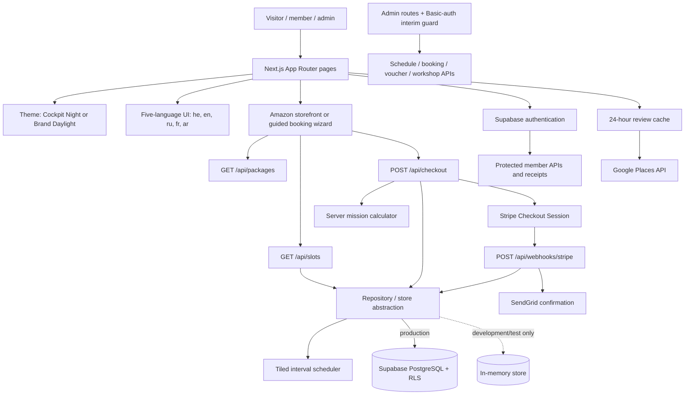

# SimDream — Master Genesis Prompt

> **Verification status:** This is a working companion prompt. For the source-verified architecture, known documentation corrections, and external configuration boundaries, read [`FULL_CODEBASE_REVIEW.md`](FULL_CODEBASE_REVIEW.md) before using this file. [`WEBSITE_GENESIS.md`](WEBSITE_GENESIS.md) is the reviewed one-shot recreation prompt.

> **Purpose.** This is a reverse-engineered, implementation-ready blueprint for rebuilding the current SimDream website from scratch. It is based on the repository's source, configuration, schema, API handlers, tests, and maintained engineering documentation as inspected on 2026-10-27. It is both a record of the discovered system and a one-shot prompt for an AI engineering agent.

## How to use this document

1. Give an AI coding agent this file together with the target repository (or the relevant source files).
2. Ask it to execute **Phase 2 — Master Genesis Prompt** without weakening the invariants.
3. Treat the runtime integrations and deployment credentials as environment configuration, never as values to invent, print, or commit.
4. Preserve the distinction between facts found in the current code and deliberate improvements called out below.

---

# Phase 1 — Reverse-engineered system analysis

## 1. Executive summary

SimDream is a multilingual, production-oriented booking and customer-success platform for a Boeing 737 MAX flight-simulator centre in Tel Aviv. It combines a high-conversion public website, a dynamically constrained appointment scheduler, Stripe checkout, Supabase-backed customer membership, digital vouchers, a B2B workshop lead funnel, and operational administration.

The central business problem is not simply selling time slots. Every booking consumes a **flight duration plus an operating turnaround buffer**, must fit local Israel operating hours, may need to co-exist with existing reservations, and is paid only after a server-validated checkout. The application exposes consumer-friendly availability while keeping identity, revenue, and operational details private.

The current implementation is a single Next.js application with server-side route handlers rather than separately deployed frontend and API services. It uses Supabase PostgreSQL as the production system of record, has a deliberately constrained in-memory store for local development/testing, and delegates payment to Stripe-hosted Checkout.

## 2. Technology stack and why each part exists

| Area | Observed implementation | Responsibility |
| --- | --- | --- |
| Language | TypeScript, strict configuration | Typed contracts across UI, APIs, scheduling, data, and tests. |
| Full stack framework | Next.js 16.4 App Router, React 19 | Server-rendered pages, client islands, API route handlers, redirects, metadata, sitemap, and production build. |
| Styling | Tailwind CSS 4, PostCSS, `clsx`, `tailwind-merge` | Responsive cockpit/brand themes and composable utility classes. |
| Validation | Zod 4 | Validates every mutable API payload before domain logic. |
| Database and identity | Supabase JS / PostgreSQL / Supabase Auth | Profiles, booking persistence, row-level security, member identity, email confirmation. |
| Payments | Stripe server SDK + Stripe.js | Hosted card Checkout, webhook signature validation, payment receipts. |
| Transactional email | SendGrid | Booking and voucher confirmation delivery from signed webhook processing. |
| Reviews | Google Places API plus local snapshot | Review display with 24-hour caching and resilient fallback. |
| UX utility | Lucide React, canvas-confetti | Accessible iconography and success-state celebration respecting reduced motion. |
| Testing | Vitest, fast-check, Playwright, axe-core, autocannon, Lighthouse CI | Domain, security, reliability, browser, accessibility, visual, performance, and load quality gates. |
| Deployment target | Vercel-compatible Next.js serverless deployment | Static/public rendering plus Node.js payment/webhook API routes. |

## 3. System topology



### Entry points and route map

**Public experience**

| Route | Intent |
| --- | --- |
| `/` | Primary marketing landing page. |
| `/about` | SimDream story, the consumer experience, and official social links. |
| `/experiences` | Recreational simulator offers. |
| `/pro` | Canonical professional airline-interview preparation route. |
| `/book` | Adaptive booking application. Supports deep-linked package selection. |
| `/book/success` | Safe post-checkout status/polling page; it does not itself confirm payment. |
| `/vouchers` | Purchase and use of gift vouchers. |
| `/workshops` | Corporate/B2B leadership workshop inquiry flow. |
| `/contact`, `/rules`, `/privacy-policy` | Operational, legal, and contact content. |
| `/simulator`, `/training` | Permanent redirects to `/pro`. |

**Authentication and membership**

| Route | Intent |
| --- | --- |
| `/login` | Email and supported identity-provider sign-up/sign-in UI. |
| `/auth/callback`, `/auth/reset-password` | Supabase Auth continuation routes. |
| `/dashboard` | Protected member flight deck with purchases, future/past sessions, and receipts. |

**Operations and administration**

| Route | Intent |
| --- | --- |
| `/admin` | Dispatch dashboard. |
| `/admin/bookings` | Booking lookup/status/rescheduling operations. |
| `/admin/vouchers` | Voucher operations. |
| `/admin/workshops` | Corporate-inquiry CRM workflow. |

## 4. Core customer and business flows

### A. Adaptive booking

The booking UI supports two presentation modes using the same availability and recovery rules:

- `AmazonFlightStorefront`: a one-page product catalogue with a sticky buy box.
- `KantorovichCalendarScheduler`: a guided wizard.

Product category determines the flow:

| Category | Packages | Flow | Add-on rule | Default pilot level |
| --- | --- | --- | --- | --- |
| `recreational` | 20, 45, 60, 90 minute consumer packages | Date/slot → add-ons → manifest/checkout | Add-ons and curated mission combinations allowed. | Visitor selects. |
| `training` | Airline Interview Prep 60/90/120 PRO | Date/operational slot → manifest/checkout | Add-on step is omitted; add-ons must be `[]`. | `atpl`. |
| `fear_of_flying` | Fear of Flying course | Date/therapeutic slot → manifest/checkout | Add-on step is omitted; add-ons must be `[]`. | `beginner`. |
| `corporate` | Workshop product | Inquiry/CRM path, not retail checkout. | Not a retail booking. | N/A. |

The user may checkout as a guest at all times. Optional authenticated membership is additive, not a gate in the retail flow.

### B. Payment and confirmation

1. Client sends identifiers and pilot/manifest data to `POST /api/checkout`; it does not send authoritative prices or calculated end times.
2. The server validates input, resolves the package and add-ons from registries, recalculates availability, duration, effective end time, prices, and voucher eligibility.
3. It creates a **pending** booking (or pending voucher) only after configuration preflight passes. A fully funded voucher is already-paid tender; a card flow requires both Stripe key and webhook secret.
4. The server creates a 30-minute Stripe Checkout session and returns the hosted URL.
5. Only a Stripe-signature-verified `checkout.session.completed` webhook marks a booking paid/confirmed or activates a voucher. Redirecting to the success page is never payment authority.
6. Confirmation email delivery uses a claim/release/complete outbox pattern so webhook retries do not lose or duplicate customer email.
7. Expired or failed Stripe sessions cancel the pending booking/voucher.

### C. Member ownership and historical purchase recovery

- Any user can buy as a guest.
- On authenticated checkout, a booking is linked only if the **confirmed identity-provider email exactly matches** the normalized checkout email.
- On member bootstrap and `GET /api/my-bookings`, the server creates/updates the profile and attaches matching **paid** historical guest bookings.
- Anonymous email search is forbidden; purchase history and receipt URLs require a verified account that owns the booking.
- Stripe receipt lookup requires a paid Stripe booking, confirmed member ownership, and a configured Stripe server client.

### D. B2B workstream

Corporate workshops are deliberately separated from B2C flight-package checkout. Visitors submit a validated inquiry; admins move it through `new → contacted → quoted → confirmed`.

## 5. Scheduling and pricing logic

The implementation calls the engine “Kantorovich,” but the source is a deterministic 15-minute tiled interval and dynamic-programming scheduler—not a general-purpose linear-programming solver. It is intentionally transparent and suitable for the finite daily capacity problem.

### Non-negotiable time rules

| Pure flight minutes | Reserved capacity minutes |
| ---: | ---: |
| 20 | 45 |
| 45 | 60 |
| 60 | 75 |
| 90 | 105 |
| 120 | 150 |
| 240 workshop | 255 |

The shared turnaround is 15 minutes, with a special 20-minute package reservation of 45 minutes. The 45-minute daytime promotion is restricted and unavailable in Saturday prime time.

| Israel local day | Operating window | Capacity rule |
| --- | --- | --- |
| Sunday–Thursday | 10:00–23:00 | 780 minutes. |
| Friday | 09:00–16:00 | 420 minutes; preserve the designated closing constraint. |
| Saturday | 19:00–24:00 | 300 minutes, prime-time pricing; 45-minute promotion forbidden. |

The engine generates candidate starts, excludes overlaps and expired departures, calculates maximum usable flight minutes before the next reservation/closing, evaluates schedule efficiency and orphan gaps, and returns a capacity-only public projection. The admin report may include full timeline, booking references, customer data, revenue, and recommended shifts. The optimizer endpoint is read-only: it proposes a capacity draft and never silently moves existing bookings.

### Zero-slots UX contract

The UI must never remove a selected or sold-out package from the DOM. A sold-out selection must show an explicit zero-slot message, a next-day action, available same-day duration alternatives, and a strikethrough booked-slot explanation. Both booking presentations must have identical availability semantics.

## 6. API contract map

| Endpoint | Method | Access | Purpose |
| --- | --- | --- | --- |
| `/api/packages` | GET | Public | Active catalog; optional category/slug selection. |
| `/api/slots` | GET | Public | Date/duration availability; optional sanitized public capacity report. |
| `/api/reviews` | GET | Public | Cached Google/local review snapshot. |
| `/api/reviews` | POST | Admin | Force a review-cache refresh. |
| `/api/checkout` | POST | Public | Validated booking or voucher checkout initiation. |
| `/api/webhooks/stripe` | POST | Stripe-signed | Authoritative payment state transitions and confirmation dispatch. |
| `/api/bookings?ref=…` | GET | Public narrow projection | Success-page lookup by high-entropy booking reference. |
| `/api/bookings` | GET/PATCH | Admin | Admin booking queries, rescheduling, and status changes. |
| `/api/vouchers` | POST | Public | Code verification with no PII disclosure. |
| `/api/vouchers` | GET/PATCH | Admin | Voucher list/redemption operations. |
| `/api/workshops` | POST | Public | Corporate workshop inquiry. |
| `/api/workshops` | GET/PATCH | Admin | Inquiry list/status update. |
| `/api/membership/bootstrap` | POST | Verified member | Profile initialization and paid guest-booking claim. |
| `/api/my-bookings` | GET | Verified member | Member-only booking history. |
| `/api/my-bookings/[ref]/receipt` | GET | Verified owner | Stripe payment receipt URL. |
| `/api/admin/schedule-efficiency` | GET | Admin | Private detailed daily schedule analysis. |
| `/api/admin/schedule-optimization` | POST | Admin | Read-only capacity optimization preview. |

Expected route-handler behavior: validate malformed requests as `400`, missing/invalid resources as `404`, conflicts as `409`, protected endpoints as `401`/`403`, unconfigured production dependencies as `503`, and never expose stack traces, secrets, payment bodies, or customer data in an error response.

## 7. Data model reconstruction

### Domain types

```ts
type PackageCategory = 'recreational' | 'training' | 'corporate' | 'fear_of_flying';
type FlightPackageDuration = 20 | 45 | 60 | 90 | 120 | 240;
type PilotExperienceLevel = 'beginner' | 'enthusiast' | 'student_pilot' | 'atpl';
type BookingStatus = 'pending' | 'confirmed' | 'completed' | 'cancelled';
type PaymentStatus = 'paid' | 'pending' | 'refunded';
type PaymentMethod = 'stripe' | 'voucher' | 'desk';
type CorporateInquiryStatus = 'new' | 'contacted' | 'quoted' | 'confirmed';
```

### Production relational model

| Table | Primary purpose | Essential fields and constraints |
| --- | --- | --- |
| `profiles` | Supabase Auth member profile | UUID PK/FK to `auth.users`; unique email; name, phone, role (`user`/`admin`), flight totals, licence, timestamps. Auth trigger creates only `user` profiles. |
| `packages` | Catalog record | Text ID/unique slug; category; allowed duration; ILS/USD/prime pricing; copy; features JSON; guest seats; availability flags. |
| `bookings` | Durable booking, payment, and customer snapshot | High-entropy `SD-737-…` reference; optional profile; package snapshot; date/time; pilot PII; add-ons JSON; money fields; state fields; Stripe intent; confirmation outbox timestamps. Enforces arithmetic and no non-cancelled reserved-range overlap. |
| `gift_vouchers` | Voucher tender/balance lifecycle | High-entropy code; values/balance; sender/recipient; expiration; paid/redeemed/refunded state; Stripe session; activation and confirmation-outbox timestamps. |
| `corporate_inquiries` | B2B lead CRM | Company/contact data, team size, target date, constrained goal/status, message, creation time. |
| `flight_logs` | Declared member-log schema | Profile/booking relation; aircraft/route; hours/landings/approach/weather; instructor sign-off. The present production repository/dashboard flow does not persist or render it yet. |

Important database safeguards:

- PostgreSQL `btree_gist` enables a GIST exclusion constraint preventing two active bookings from occupying the same reserved range.
- `redeem_gift_voucher(code, amount)` locks the qualifying row with `FOR UPDATE` for atomic balance reduction.
- RLS is enabled. Browser roles may read only active packages; direct access to bookings, vouchers, corporate inquiries, and flight logs is revoked.
- Migrations harden production data, add member claiming, normalize exact booking emails, and implement the confirmation outbox.

## 8. Security, resilience, and operations posture

### Existing safeguards

- Production fails closed when Supabase, Stripe, webhook signing, or required application origin configuration is absent. The in-memory store is local/test only.
- The server owns package price, flight duration, add-on duration, reservation fit, end time, and discount computation.
- Checkout uses Stripe-hosted payment collection; no card details traverse application routes.
- Webhook signature verification and idempotent state changes are mandatory.
- Admin access is server-side HTTP Basic Auth with constant-time comparison, same-origin mutation checks, and configuration failure as `503`. It is marked in code as interim, to be replaced by Supabase role-based admin authentication and MFA.
- The Next.js configuration sends CSP, clickjacking, HSTS, referrer, MIME-sniffing, and permissions-policy headers. Static CSP currently permits `unsafe-inline` because App Router RSC payloads require it; a nonce-based CSP is a deliberate trade-off that would make pages dynamic.
- The system minimizes public projections: availability has no customer/revenue data; success lookup omits PII; voucher validation omits PII; member purchase access is ownership checked.
- Reviews use a local, clearly labelled fallback snapshot when Google Places is unavailable.
- Test execution blanks external secrets and uses isolated `.next-test` output so automated builds cannot charge a card, email a customer, or corrupt a developer preview.

### Known improvement work for a fresh production build

The current test registry identifies these gaps. A new implementation should close them rather than reproduce them:

1. Rate-limit voucher verification by IP and voucher code, returning `429` with `Retry-After`.
2. Rate-limit/back off failed admin authentication; replace Basic Auth with role-based Supabase Auth and MFA before production scale.
3. Choose and document the CSP trade-off: static rendering with inline RSC allowance, or per-request nonce CSP with its caching/rendering cost.
4. Add an integration environment running real PostgreSQL to verify the database exclusion constraint and production migrations.
5. Extend browser coverage for admin mutations, signed-in receipt flows, success-page polling, booked-slot transparency, all scheduling day grids, SEO, and transactional-email rendering.

## 9. Design, localization, and customer-success requirements

- Brand identity is the provided SimDream logo asset: orange airplane, cerulean wordmark, translated text tagline. Do not reconstruct or mirror the artwork.
- Brand tokens: cerulean `#2096C7` / Tailwind `sky-500`; orange `#FF5500` / Tailwind `orange-500`. Ensure WCAG AA contrast; orange small text on light surfaces uses a darker orange.
- Themes: Cockpit Night is default; Brand Daylight is a fully supported alternative. Persist user intent without hydration flicker.
- Languages: Hebrew (`he`, RTL), English (`en`, LTR), Russian (`ru`, LTR), French (`fr`, LTR), Arabic (`ar`, RTL). Every key exists in all five locales.
- Use RTL only for layout. Never substitute Hebrew copy merely because a language is RTL. Keep aviation telemetry, times, ICAO, booking references, and radio values in LTR `bdi` contexts.
- Calendar presentation is local-language aware, defaults to month view, and preserves ISO dates internally. First day of week differs by locale; no locale may fall back to English labels.
- Accessible interfaces require semantic headings, labelled forms, live validation feedback, keyboard-operable dialogs, reduced-motion support, minimum 44×44 touch targets, and both desktop/mobile validation.

## 10. Quality framework recovered from the source

The quality model is unusually strong and should be carried forward:

- Type-checking and strict domain contracts.
- Vitest unit, integration, security, and reliability suites, including property tests for scheduling edges.
- Browser journeys in Chromium, Firefox, WebKit, Android Chrome, and iPhone Safari profiles.
- Automated axe WCAG 2.x AA checks with an empty baseline as the target.
- Usability tests for hydration, all languages/RTL, responsive header fit, layout stability, and motion preferences.
- Security-web tests for headers, access control, disclosure, and stored XSS.
- Resilience tests for slow, failing, and offline booking conditions.
- Visual regression baselines, autocannon p99 smoke budgets, and Lighthouse budgets.
- CI runs the quality layers on pull requests and `main`; nightly passive OWASP ZAP scans report findings.

---

# Phase 2 — Master Genesis Prompt

Copy the complete prompt below into an AI coding agent with an empty repository or a target implementation repository.

```text
ROLE
Act as a principal full-stack architect, staff product engineer, security engineer, QA lead, DevOps engineer, and customer-experience designer. Build a production-ready website and operations dashboard for SimDream, a Boeing 737 MAX flight-simulator centre in Tel Aviv, Israel. Do not create a generic booking demo: implement the operational, payment, scheduling, accessibility, multilingual, and customer-ownership rules below exactly.

OUTCOME
Deliver a secure, tested, multilingual web application that lets a visitor discover authentic simulator experiences, book a valid operational slot, buy a voucher, submit a corporate workshop request, optionally become a member, and later see owned purchases and Stripe receipts. It must also give authorized staff a private dispatch/admin console. Provide readable engineering documentation, SQL migrations, env examples, and automated tests.

PROJECT TYPE AND BRAND CONTEXT
- Business: Boeing 737 flight-simulator experiences. Core value is realistic captain command, active airline-pilot mentorship, worldwide airport/weather choice, milestone/fear-of-flying transformation, and aviation authenticity.
- Location and operational timezone: Gershon Shatz St 36, Tel Aviv-Yafo, Israel; all schedule calculations use Asia/Jerusalem.
- Brand: use supplied logo assets only, never text/icon re-creations. Cerulean #2096C7 is the primary color and orange #FF5500 the highlight. Offer Cockpit Night (default) and Brand Daylight themes. Meet WCAG AA contrast in both.
- The customer-story page is /about. Professional training is /pro. Do not conflate these routes. Redirect /simulator and /training permanently to /pro.

TECH STACK DIRECTIVES
- Next.js 16 App Router + React 19 + TypeScript strict mode.
- Tailwind CSS 4 and composable class helpers.
- Zod for every mutable input boundary.
- Supabase Auth + PostgreSQL with RLS for production persistence.
- Stripe-hosted Checkout plus signed Stripe webhooks; do not accept card data directly.
- SendGrid for confirmation email, Google Places for review refresh with a static local fallback.
- Use a repository/store abstraction so a deterministic in-memory implementation is available only during development/testing. Production must fail closed when Supabase configuration is absent.
- Use Vitest, fast-check, Playwright, axe-core, autocannon, and Lighthouse CI. Test builds must write to a separate dist directory, never the developer's normal .next output.
- Deploy as a Vercel-compatible Next.js application. Use environment variables; never place secrets in the browser bundle, repository, logs, or fixtures.

PUBLIC ROUTES AND APPLICATION AREAS
Create these routes:
- Public: /, /about, /experiences, /pro, /book, /book/success, /vouchers, /workshops, /contact, /rules, /privacy-policy.
- Auth/member: /login, /auth/callback, /auth/reset-password, /dashboard.
- Admin: /admin, /admin/bookings, /admin/vouchers, /admin/workshops.
- Redirect /simulator and /training with permanent redirects to /pro.

FUNCTIONAL REQUIREMENTS
1. Product catalogue and adaptive booking
   - Model categories recreational, training, corporate, fear_of_flying.
   - Recreational packages: 20, 45, 60 and 90 minutes and a three-step flow: date/slot → optional mission add-ons → pilot manifest/checkout.
   - Training: official Airline Interview Prep 60 PRO (ILS 890), 90 PRO (ILS 1,250), and 120 PRO (ILS 1,590). Explain ATP/airline interview preparation clearly: technical/procedural practice, simulator assessment confidence, airline-style briefing and debrief. Use a two-step flow: date/operational slot → pilot manifest/checkout. Force the pilot experience default to ATPL and suppress all recreational add-ons.
   - Fear-of-flying course: two-step therapeutic flow, beginner default, no recreational add-ons.
   - Corporate workshops must use a B2B inquiry/CRM flow, separate from consumer retail checkout.
   - Supply both a one-page Amazon-style storefront with sticky buy box and a guided calendar wizard. Both must share exactly the same availability API, duration rules, empty-state recovery, and server checkout.
   - A package with no availability remains visible and selected. Show the zero-slot count/message, a next-day action, viable same-day duration alternatives, and booked slots struck through for transparency.

2. Deterministic scheduling
   - Treat the engine as a deterministic tiled interval / dynamic-programming scheduler, not a vague claim of linear programming.
   - Generate candidate departures at 15-minute boundaries, reject overlaps, closing-time overrun, restricted promotions, and past departures.
   - Reserve capacity by pure flight duration: 20→45, 45→60, 60→75, 90→105, 120→150, 240→255 minutes. These are capacity blocks, not merely display durations.
   - Operating windows: Sunday–Thursday 10:00–23:00; Friday 09:00–16:00; Saturday 19:00–24:00 prime time. The 45-minute daytime promotion cannot be booked in Saturday prime time.
   - Compute a package's maximum additional mission capacity before the next booking/closing. Reject add-ons that no longer fit.
   - Produce both a public capacity report without customer/revenue data and an admin efficiency report with gaps, revenue, reservation timeline, and recommendations.
   - Provide an admin-only optimizer endpoint that returns a draft recommendation but never automatically changes a confirmed reservation.

3. Checkout and payment authority
   - Client checkout requests contain only package/slot/add-on identifiers plus manifest/contact data. Server code must look up all prices, durations, discount rules, and end times.
   - Validate every request with Zod. Check the slot again immediately before persistence. Convert schedule conflicts to 409.
   - Guests can always complete checkout. Authentication must never be required to buy.
   - For card payments, require a usable Stripe secret key and webhook signing secret before making a pending booking. Otherwise return a clear 503 and leave no spent voucher/held booking behind.
   - Create Stripe Checkout sessions for ILS payment with a 30-minute expiry and a server-controlled success/cancel URL.
   - Only a Stripe-signature-verified checkout.session.completed event with paid status can mark a booking paid and confirmed or activate a voucher. The success page is display/polling only.
   - Make webhook transitions idempotent. On session expiration/async failure cancel pending records. If payment arrives after a staff cancellation, record it safely for refund handling without reviving a re-sold slot.
   - Use a claim/send/complete confirmation outbox. Release the claim and return 5xx if SendGrid fails, so Stripe retries. Treat stale claims as recoverable.

4. Identity, ownership, and membership
   - Support email/password and configured Google, Facebook, and Apple OAuth through Supabase Auth.
   - Create least-privilege member profiles from auth users. Never grant admin because of email or client metadata.
   - A booking is attached at checkout only when the authenticated provider-confirmed email equals the normalized checkout email.
   - On verified-member bootstrap and booking-history retrieval, attach matching historical paid guest bookings exactly by normalized email. Never let a newly registered account see an unpaid hold or another email's purchases.
   - Keep anonymous checkout. Do not expose lookup-by-email endpoints to anonymous users.
   - Dashboard shows purchases, past and upcoming sessions, and eligible Stripe receipt links. A receipt request verifies member ownership and returns a Stripe-hosted receipt URL only for paid Stripe bookings.

5. Vouchers, reviews, and B2B
   - Support purchase, activation, validation, and atomic full-order redemption of high-entropy vouchers. A voucher must be paid, unexpired, unredeemed, and have sufficient balance. Use database row locking for redemption.
   - Keep voucher validation responses free of personal/payment metadata. Rate-limit it by IP and code, returning 429 and Retry-After on abuse.
   - Cache Google Places reviews for 24 hours, sort useful review text deterministically, and gracefully display a clearly labelled local snapshot if the external API is absent or fails. Admins may manually refresh.
   - Store validated corporate workshop leads and support the statuses new, contacted, quoted, confirmed.

6. International, accessible, and resilient user experience
   - Fully localize every customer and member surface into Hebrew (RTL), English (LTR), Russian (LTR), French (LTR), Arabic (RTL). Add every translation key in all five languages in the same change.
   - Never use an isRTL conditional to select language copy; RTL affects layout only. Never place Hebrew characters in Arabic copy or Arabic characters in Hebrew copy.
   - Render all aviation telemetry, times, booking references, ICAO codes, radio frequencies, and transponder codes in LTR isolation.
   - Localize calendar labels, week starts, date order and numerals per language while preserving ISO date values internally. Default to month view and permit a locale-aware week view.
   - Include labels, semantic headings, keyboard navigation, modal focus management, inline/live form errors, 44px touch targets, reduced-motion behavior, responsive layouts from 320px through 1920px, and no hydration-time clock mismatch.

DATABASE SCHEMA AND MIGRATIONS
Use PostgreSQL/Supabase. The following logical schema is mandatory; use appropriate timestamp defaults, nonnegative money checks, indexes, foreign keys, and RLS.

```sql
create table profiles (
  id uuid primary key references auth.users(id) on delete cascade,
  email text not null unique,
  full_name text not null,
  phone_number text,
  role text not null default 'user' check (role in ('user','admin')),
  total_flight_hours numeric(6,2) not null default 0 check (total_flight_hours >= 0),
  total_flights integer not null default 0 check (total_flights >= 0),
  pilot_license text,
  created_at timestamptz not null default now(), updated_at timestamptz not null default now()
);

create table packages (
  id text primary key, slug text not null unique, title text not null,
  category text not null check (category in ('recreational','training','corporate','fear_of_flying')),
  duration_minutes integer not null check (duration_minutes in (20,45,60,90,120,240)),
  price_ils numeric(10,2) not null check (price_ils >= 0),
  prime_time_price_ils numeric(10,2) check (prime_time_price_ils >= 0),
  price_usd numeric(10,2) not null check (price_usd >= 0),
  short_desc text not null, description text not null, featured boolean not null default false,
  badge text, daytime_only boolean not null default false,
  kantorovich_var text check (kantorovich_var in ('x1','x2','x3','x4','pro')),
  yield_per_min_ils numeric(10,2) check (yield_per_min_ils >= 0),
  features jsonb not null default '[]', includes_briefing boolean not null default true,
  instructor_included boolean not null default true, guest_seats integer not null default 2 check (guest_seats >= 0),
  is_active boolean not null default true, created_at timestamptz not null default now()
);

create table bookings (
  id uuid primary key default gen_random_uuid(),
  booking_reference text not null unique check (booking_reference ~ '^SD-737-[A-Z2-9]{16}$'),
  user_id uuid references profiles(id) on delete set null,
  package_id text not null, package_title text not null,
  duration_minutes integer not null check (duration_minutes between 20 and 240),
  booking_date date not null, start_time time not null, end_time time not null,
  pilot_name text not null, pilot_email text not null check (pilot_email = lower(btrim(pilot_email))), pilot_phone text not null,
  experience_level text not null check (experience_level in ('beginner','enthusiast','student_pilot','atpl')),
  addons jsonb not null default '[]', subtotal_ils numeric(10,2) not null check (subtotal_ils >= 0),
  discount_ils numeric(10,2) not null default 0 check (discount_ils >= 0), total_ils numeric(10,2) not null check (total_ils >= 0),
  voucher_code text, status text not null default 'pending' check (status in ('pending','confirmed','completed','cancelled')),
  payment_status text not null default 'pending' check (payment_status in ('pending','paid','refunded')),
  payment_method text not null default 'stripe' check (payment_method in ('stripe','voucher','desk')),
  stripe_payment_intent text unique, notes text,
  confirmation_claimed_at timestamptz, confirmation_sent_at timestamptz, created_at timestamptz not null default now(),
  check (discount_ils <= subtotal_ils), check (total_ils = subtotal_ils - discount_ils),
  check ((payment_method = 'voucher' and payment_status = 'paid') or payment_method <> 'voucher')
);
-- Add btree_gist and a partial GIST EXCLUDE constraint over each non-cancelled booking's reserved time range.

create table gift_vouchers (
  id uuid primary key default gen_random_uuid(), code text not null unique check (code ~ '^SD-VOUCH-[A-Z2-9]{18}$'),
  initial_value_ils numeric(10,2) not null check (initial_value_ils > 0),
  current_balance_ils numeric(10,2) not null default 0 check (current_balance_ils >= 0 and current_balance_ils <= initial_value_ils),
  recipient_name text not null, recipient_email text not null, sender_name text not null, sender_email text not null,
  personal_message text, package_id text, package_title text, expiry_date timestamptz not null,
  is_redeemed boolean not null default false, payment_status text not null default 'pending' check (payment_status in ('pending','paid','refunded')),
  stripe_checkout_session_id text unique, activated_at timestamptz,
  confirmation_claimed_at timestamptz, confirmation_sent_at timestamptz, created_at timestamptz not null default now()
);

create table corporate_inquiries (
  id uuid primary key default gen_random_uuid(), company_name text not null, contact_name text not null,
  email text not null, phone text not null, team_size integer not null check (team_size between 1 and 500), target_date date,
  primary_goal text not null check (primary_goal in ('leadership','team_communication','high_stress_decision_making','vip_incentive')),
  message text, status text not null default 'new' check (status in ('new','contacted','quoted','confirmed')),
  created_at timestamptz not null default now()
);

create table flight_logs (
  id uuid primary key default gen_random_uuid(), user_id uuid references profiles(id) on delete cascade,
  booking_id uuid references bookings(id) on delete set null, flight_date date not null, aircraft_type text not null default 'B737-MAX8',
  flight_time_hours numeric(4,2) not null check (flight_time_hours >= 0), departure_icao text not null default 'LLBG',
  arrival_icao text not null, landings_count integer not null default 1 check (landings_count >= 0),
  approach_type text not null check (approach_type in ('CAT_III_ILS','RNP_AR','VISUAL','RNAV')),
  weather_scenario text, instructor_signature text not null, notes text, created_at timestamptz not null default now()
);
```

Implement migrations for: production hardening and booking overlap detection, verified member accounts/profile trigger, exact normalized email matching, and exactly-once confirmation outbox fields. Enable RLS. Allow public direct SELECT only for active package catalog rows; revoke direct browser access to bookings, vouchers, corporate inquiries, and logs. Serve those operations through authenticated server code.

API CONTRACTS
- GET /api/packages?category=&slug=
- GET /api/slots?date=YYYY-MM-DD&duration=&includeEfficiency=true
- GET/POST /api/reviews (POST admin)
- POST /api/checkout for discriminated booking/voucher input
- POST /api/webhooks/stripe (signature verified)
- GET/PATCH /api/bookings (admin except narrow high-entropy ?ref= public projection)
- GET/POST/PATCH /api/vouchers with public code verification isolated from admin mutations
- GET/POST/PATCH /api/workshops
- POST /api/membership/bootstrap; GET /api/my-bookings; GET /api/my-bookings/[bookingReference]/receipt
- GET /api/admin/schedule-efficiency; POST /api/admin/schedule-optimization

SECURITY AND OPERATIONAL RULES
- Do not use client-provided money, end time, package title, discount, or payment status as authority.
- Use strict response projections; never expose PII, revenue, or internal schedule details in public capacity endpoints.
- Configure CSP, HSTS, frame denial, strict referrer policy, nosniff, form-action, and a minimal permissions policy. Document any App Router inline-script trade-off.
- Admin actions must use server-side RBAC and same-origin protections. Do not ship Basic Auth as the long-term production solution.
- All persistence/payment/provider outages must return generic safe errors. Log sufficient operational context server-side without secrets or customer data.
- Add abuse controls to voucher verification, authentication, checkout attempts, and other high-risk endpoints.

SUGGESTED FILE STRUCTURE
app/
  (public)/{about,book,contact,experiences,pro,rules,vouchers,workshops}/
  (auth)/login/  auth/{callback,reset-password}/  dashboard/  admin/
  api/{packages,slots,checkout,reviews,vouchers,workshops,bookings,membership,my-bookings,webhooks,admin}/
  layout.tsx globals.css sitemap.ts robots.ts
components/
  brand/ layout/ scheduler/ pro/ reviews/ legal/ seo/ ui/
lib/
  auth/ booking/ config/ data/ db/{migrations}/ i18n/ reviews/ scheduler/ seo/ theme/ ui/
types/  tests/{unit,integration,security,reliability,e2e,a11y,usability,visual,load,perf}/  scripts/  public/brand/

TEST AND ACCEPTANCE CRITERIA
- TypeScript typecheck and production build pass with no errors.
- Unit/property tests prove every duration, operating window, DST edge, gap rule, no-overlap rule, pricing rule, and booking-category add-on rule.
- Integration tests cover every API status contract, authorisation boundary, webhook replay, failed persistence, card configuration failure, and concurrent checkout.
- Browser tests cover consumer, PRO, fear-of-flying, zero-slots recovery, voucher, workshop, membership, success, dashboard, admin, theme, all five languages, mobile and desktop.
- Axe accessibility baseline is empty. Visual baseline changes are reviewed deliberately. Load p99 and Lighthouse budgets are enforced in CI.
- Add concise README, architecture diagram, scheduler specification, calendar-localization guide, and testing guide. Include .env.example without real credentials.

DELIVERY DISCIPLINE
Work in small cohesive changes. Inspect framework docs before using changed APIs. Prefer server-authoritative pure domain modules. Keep every data contract strongly typed with no `any`. Run the relevant tests after each layer and the complete quality suite before declaring the system complete. Report assumptions explicitly rather than silently weakening a safety, booking, ownership, or locale invariant.
```

---

## Optional poster-image prompt

Use this only when creating the companion artwork, not as the engineering prompt itself:

> Create a 3840×2160 high-resolution landscape infographic named **“ONE-SHOT WEBSITE GENESIS”**. Use a polished dark Boeing-cockpit HUD / avionics blueprint visual language, SimDream cerulean `#2096C7` and orange `#FF5500`, precise high-contrast typography, no watermark, and no fake logos. Structure the poster in five legible zones: (1) a title and telemetry bar: “Next.js 16 • Deterministic Tiled Scheduler • i18n: 5 Languages • Fail-Closed Security • Quality Gates”; (2) system topology from visitor → Next.js App Router → schedule/mission engine → Supabase/Stripe/Google/SendGrid; (3) operational capacity map 20→45, 45→60, 60→75, 90→105, 120→150 and Israel weekly operating windows; (4) a “Master AI Meta-Prompt” panel highlighting brand pillars, canonical routes, noise-free professional flow, member ownership, and webhook authority; (5) a quality pipeline TypeScript → Vitest → Playwright/Axe → autocannon/Lighthouse. Keep body text short and readable; use the full `MASTER_GENESIS_PROMPT.md` as the detailed textual companion.
