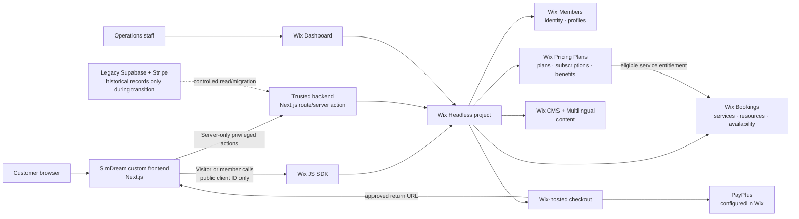
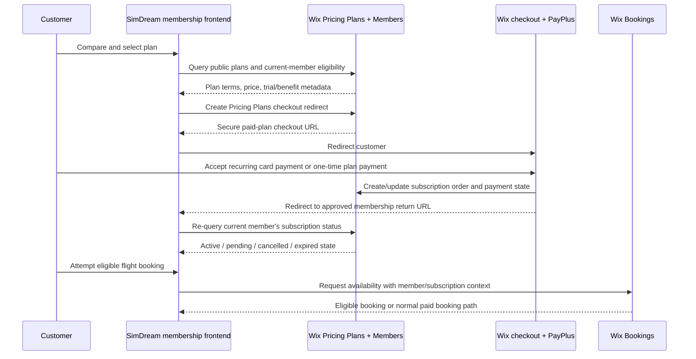

# Wix Headless Integration Architecture & DevOps Plan

**Status:** The native Wix staging backend is provisioned on **SimDream-Staging** (`317b0c6d-6608-499a-bb3c-b1c37650e460`): Bookings services, operating availability, a single simulator resource, Pricing Plans and plan-to-service benefits are configured and verified. The Wix Members Area, exact hosted-member callback URI, six-language member subscription panel, duration-aware availability adapter, guest/member base-flight checkout, and member-bound subscription redemption handoff are active on staging. `/login` now starts the Wix-hosted member journey and `/dashboard` verifies the returned Wix token server-side before reading only that member's Calendar appointments; active Pricing Plan orders remain visible in the shared subscription panel. Calendar data is intentionally not relabelled as a paid order, invoice, or Stripe receipt. When `WIX_AVAILABILITY_ADAPTER_ENABLED=true`, Wix is the calendar authority: a base-flight browser checkout revalidates, creates the Wix booking, and writes the once-completed manifest name, email and phone to the visitor's Cart V2 `customerInfo` before opening the hosted payment page; the local checkout endpoint refuses to create a competing reservation. Add-ons and on-request routes remain intentionally blocked in this mode until mapped to native Wix entities. Native customer Gift Card purchase issuance remains a separately verified headless checkout contract. There is no connected PayPlus provider, server-side Wix booking writer, application-owned entitlement-credit ledger, or native invoice adapter. Use [`WIX_HEADLESS_CUTOVER_RUNBOOK.md`](WIX_HEADLESS_CUTOVER_RUNBOOK.md) and `npm run wix:readiness` before payment-provider activation.

**Authority:** [`GENESIS.md`](../GENESIS.md) remains the canonical description of the currently running Next.js/Supabase/Stripe system. This document describes a deliberate future integration or migration path to Wix Headless.

### Wix Multilingual URL and checkout contract (2026-11-12)

Wix Multilingual is configured with **Hebrew as the primary locale** and a **subdirectory** URL structure. The public frontend therefore treats these as canonical URLs: Hebrew at `/`, and English, Russian, French, Arabic and Spanish at `/en`, `/ru`, `/fr`, `/ar` and `/es` respectively (with the same prefix retained for every internal page). `proxy.ts` rewrites only those secondary prefixes to the single Next.js route tree and forwards the locale to the root layout. The language selector changes both the visible language and the URL; core header and footer navigation preserve that prefix. The application continues to support exactly its six shipped languages. German may remain visible in Wix configuration, but has no public prefix until German content and QA are delivered.

For Wix **redirect-session** flows (Pricing Plans purchase and member subscription booking), the client passes the selected language through the documented `preferences.additionalQueryParameters.lang` and uses localized return URLs. That is the supported way for Wix-managed checkout to select the page language. The one-off base-flight Cart V2 flow has a narrower documented API: `get-checkout-url` offers a cart checkout URL (and optional currency) but no locale or callback fields. SimDream therefore preserves that returned URL exactly rather than appending an unsupported parameter. A controlled staging purchase must still verify the final email/service-name language, native Cart V2 checkout language, payment outcome and return behavior before declaring those parts complete.

## 1. Executive decision

SimDream should treat Wix Headless as a business platform, not as a replacement for the SimDream customer experience. The existing frontend owns the aviation product experience, multilingual UX, accessibility, package education, and custom scheduling presentation. Wix owns the business records and native operations that it is good at: Bookings, Members, checkout, payment-provider configuration, CMS content, notifications, and staff dashboards.

**Subscriptions are a separate commercial domain from one-off simulator bookings.** Wix Pricing Plans is the proposed authority for plan catalogue, recurring billing terms, trials, plan orders (called subscriptions by Wix), cancellation state, and plan-to-Booking benefits. The SimDream frontend renders the membership offer and member experience; it must not create a second recurring-billing system.

### Current flight-subscription catalogue: public offer, not a live entitlement

The frontend now has a six-language catalogue in `lib/data/subscription-passes.ts`, rendered on `/subscriptions` and in the `/experiences` Flight Subscriptions category. It deliberately models **single-payment flight subscriptions**, not recurring card billing and not a replacement for an individual Wix Booking:

| Public subscription | Included sessions | Base booking package | Single-payment price | Standard base-session value | Curriculum focus |
| --- | --- | --- | ---: | ---: | --- |
| Flight Foundations | 5 × 60 min | `pkg-captain-60` | ₪2,750 | ₪3,450 | Cockpit orientation, FMS logic, weather, crosswind and ILS foundations |
| Advanced Captain | 5 × 90 min | `pkg-ultimate-90` | ₪3,390 | ₪4,250 | SOP rationale, instruments, weather, abnormal-situation communication |
| ATPL Concepts | 10 × 60 min | `pkg-captain-60` | ₪4,850 | ₪6,900 | Systems, planning, FMC, IFR, CRM and TEM explanations |
| Airline Readiness | 10 × 90 min | `pkg-ultimate-90` | ₪5,950 | ₪8,500 | Raw-data concepts, QRH thinking, two-pilot communication and a line-oriented mission |

All four subscriptions are valid for 12 months. Their price, package relationship and savings calculations are a type-safe local offer registry (`SUBSCRIPTION_PASSES`). `/subscriptions` requires a Wix Member for a plan purchase, using the Wix-hosted sign-in/register page and the callback at `/wix/members/callback`; no client secret is used. A signed-in browser resolves its plan through `POST /api/subscriptions/checkout` and creates the `paidPlansCheckout` redirect with its own Wix member session, so Wix attributes the plan order to that member. The same page reads that member's active Wix plan orders with `@wix/members` and `@wix/pricing-plans`; each plan exposes a duration-matched **Book a covered session** link. `/book?subscription=wix` keeps the strict SimDream calendar and calls `POST /api/wix/bookings/checkout` only to resolve the current native time-slot object. The signed-in browser then creates a Wix `bookingsCheckout` redirect, where Wix—not React or the API route—verifies eligibility and consumes the benefit. If a plan is not configured or published in Wix, purchase falls back to Captain Dispatch with validated plan metadata. `npm run wix:readiness` is the no-write preflight and requires both Bookings parity and all four plans to resolve before a cutover decision.

The catalogue can surface Cold & Dark, Crosswind/IFR and Extreme Airports as instructor-led **training themes**. It must not quietly add an add-on's separately listed time to a booking, waive its price, or imply that the customer has a credit. The final entitlement must explicitly decide whether an add-on is (a) a lesson theme inside the base session, (b) a chargeable time extension, or (c) a separately metered subscription benefit. ATPL-level explanations are educational simulator coaching—not logged flight time, a licence, type rating, assessment credit or airline-employment guarantee.

To complete the full member entitlement lifecycle, create one approved one-time Wix Pricing Plan per row, map its immutable Wix plan id to the local subscription id on the trusted server (`WIX_PLAN_IDS`), require the Wix Member identity required by Pricing Plans checkout, and enforce an idempotent server-side credit/expiry ledger immediately before slot reservation. Only a Wix-confirmed order may create or consume a subscription entitlement; a post-checkout browser return is never confirmation.

For the existing application, the safest first implementation is **self-managed Next.js frontend + Wix Headless business backend**:

- Keep the existing Next.js application and its tests intact.
- Connect the frontend to a dedicated Wix Headless project through the Wix JavaScript SDK.
- Move one bounded capability first: customer booking and checkout.
- Keep current Supabase/Stripe history read-only until there is an approved data-migration plan.
- Configure PayPlus inside Wix, never in browser code or in the Next.js repository.

Wix-managed hosting is now configured for the existing Next.js frontend. `npm run wix:build` first uses `@opennextjs/cloudflare` to produce the Cloudflare-Worker-compatible server and static assets, normalizes OpenNext's optional unused Durable Object exports for Wix's runtime, then runs a no-upload Wrangler bundle to produce the single ESM worker artifact Wix executes. `scripts/prepare-wix-worker.mjs` writes Wix's required `entry.mjs` bootstrap and supplies the `waitUntil()` shape that Wix's runner omits; it deliberately removes the non-runtime source map from the upload. It also rewrites Wrangler's `\uXXXX` escapes back to UTF-8 (`scripts/wix-worker-charset.mjs`, the equivalent of esbuild's `charset: 'utf8'`; the six-language UI and the Hebrew blog corpus otherwise cost six bytes per character) and fails the build when the worker exceeds its 14 MiB budget, because Wix refuses a deployment near 20 MB with HTTP 413 (`wix-bundle` job in `ci.yml`). Keep large data such as `lib/data/blog-posts.json` out of client components and of modules they share with server code, or Turbopack bundles one copy per layer (server, SSR and browser). `npm run wix:release` publishes that prepared output through the Wix CLI. `wix.config.json` contains only the public OAuth client id and metasite id for **SimDream-Staging** (`317b0c6d-6608-499a-bb3c-b1c37650e460`); no payment, Supabase, Stripe, Wix API, or client-secret value belongs in this file. A Wix-managed non-Astro frontend still owns its own authentication/session implementation. Do not rewrite the frontend merely to claim that the site is “on Wix.”

### Provisioned native staging backend (2026-11-05)

The following records were created or updated only on **SimDream-Staging**. They are not a production cutover and do not change the live Editor site or the current Next.js booking writer.

| Domain | Staging configuration and verified behavior |
| --- | --- |
| Site basis | Country `IL`, currency `ILS`, time zone `Asia/Jerusalem`; Wix Bookings and Wix Pricing Plans are installed. |
| Base availability | The SimDream calendar capacity window is **09:00–24:00, Sunday–Saturday** (`Asia/Jerusalem`, including daylight-saving transitions). It is the outer zero-waste grid only: Wix Bookings returns a departure as bookable only when the assigned staff member and the shared Boeing 737 resource are available. This keeps the calendar broad enough for operating capacity without bypassing staff availability. |
| Simulator capacity | One native `Boeing 737 Flight Simulator` resource is required by all nine services, preventing two service types from taking the physical simulator at the same time. |
| Staff calendars | Every provider referenced by the nine appointment services (`Nathanel S`, `SimDream Flight Operations`, and `SimDream Daytime Promotion Availability`) is attached to the Wix default business-hours policy; their actual working hours are the final availability constraint inside the 09:00–24:00 calendar capacity window. The shared Boeing resource remains the capacity authority. Customer checkout omits a staff `resource` unless the customer has explicitly chosen an instructor, so Wix performs its configured automatic assignment rather than mistaking the shared simulator capacity resource for a staff member. |
| Test coupon | A short-lived, 30-use, 100% coupon is scoped to the `bookings` namespace (all services) on staging for client-flow QA. It is neither a Stores discount nor a production promotion. |
| Service registry | All nine `SIMULATOR_PACKAGES` have one public, fixed-duration Wix appointment service, with their ILS base price, duration, turnaround buffer, and source mapping in `lib/wix/catalog.ts`. Keeping the services fixed preserves the separate 45-minute promotion, 90-minute tariff, and duration-matched Pricing Plan benefits. The headless availability and checkout resolver enforces the 45-minute ₪490 Discounted Promotion as Sunday–Tuesday before 18:00 only, then intersects that rule with Wix's live availability. Every mapped service requires the shared Boeing 737 resource type; `npm run wix:smoke` and `npm run wix:readiness` fail if that availability-pool invariant or catalog parity drifts. |
| Flight subscriptions | Four public, buyable one-time 12-month Pricing Plans exist for the four subscription passes. The two 60-minute plans are eligible for the 60-minute service and the two 90-minute plans are eligible for the 90-minute service through the native Bookings/Pricing Plans association. |
| Gift Cards | The custom `/vouchers` checkout has seven Apple-style visual selections (`skyline` ₪50, `ivory` ₪100, `moonlight` ₪200, `aurora` ₪300, `sunset` ₪500, `dusk` ₪700, `pearl` ₪1,000), each mapped 1:1 in `lib/catalog/gift-card-designs.ts` and `lib/wix/catalog.ts` (`WIX_GIFT_CARD_PRODUCT_ID`, `WIX_GIFT_CARD_VARIANT_IDS`) to its live Wix Gift Card `variantId` and `wixMediaId` on **SimDream-Staging**. When `isWixConfigured()` is active, `POST /api/checkout` (`kind: 'voucher'`, `voucherType: 'gift_card'`) uses `createWixGiftCardCheckoutRedirect()` (`lib/wix/gift-cards.ts`) to create a native Wix eCommerce Cart V2 + Redirects V1 hosted checkout session with the selected variant and recipient metadata; otherwise it falls back to the local voucher ledger (`gift_card_design_id`) and Stripe Checkout. |
| Wix Members | The Members Area app is installed. The OAuth app allow-lists the hosted staging callback and preview wildcard for `/wix/members/callback`; the customer chooses Wix-hosted sign-in or registration. |
| Availability adapter | `WIX_AVAILABILITY_ADAPTER_ENABLED=true` is set only for staging. `lib/wix/availability-adapter.ts` intersects Wix's live bookable starts with the duration-aware Kantorovich grid (30m → 45m reserved cadence, 45m → 60m, 60m → 75m, 90m → 105m, 120m → 150m). If local persistence is unavailable, it serves the same generated grid limited by Wix. |
| Subscription redemption | `lib/wix/subscription-booking.ts` resolves an exact live 60m or 90m Wix slot only after it also passes the Kantorovich grid. The browser's member session opens Wix-hosted `bookingsCheckout`; Wix validates the linked Pricing Plan benefit and records the final booking. |

Wix may present a broader appointment raster than SimDream's package cadence. `timeBetweenSessions` is configured in Wix, but a Wix availability result alone must not replace `getReservedMinutesForFlight()` or the zero-waste validation. The availability adapter therefore retains the duration-aware local grid and lets Wix veto starts that are no longer bookable. When it is enabled, its response marks Wix as authoritative and the local checkout route refuses booking writes; native base-flight checkout revalidates the exact slot, creates the Wix reservation, then hydrates the visitor-owned Cart V2 `customerInfo` from the manifest before hosted checkout. This removes duplicate name, email and phone collection without exposing payment data to React. Add-ons and voucher concepts that lack native Wix entities are not allowed to fall back to a competing local calendar. Subscription redemption similarly hands one validated native slot to Wix-hosted checkout in the member browser session, while Wix remains the final benefit and reservation authority.

The native setup deliberately does **not** fabricate payment or credit state. As of this verification, Wix reports no connected payment provider. A documented Wix App Market search found no published PayPlus listing that can be installed programmatically for this staging site, so no unknown third-party app identifier was used. Connect an approved PayPlus provider from the Wix **Accept Payments** settings with the merchant's sandbox credentials, then test a non-live payment flow. A paid-plan browser return is still not a flight-credit entitlement: a trusted, idempotent order-to-credit adapter is required before a subscription may consume a booking slot.

The Wix-hosted frontend responds on `/`, `/book`, and `/api/packages`. With `WIX_AVAILABILITY_ADAPTER_ENABLED=true`, `/api/slots` can serve Wix-backed availability even when the worker has no approved Supabase persistence connection; its fallback is a safe calendar rather than an in-memory order store and it declares `wixBookingsAuthoritative: true`. `POST /api/wix/bookings/checkout` intentionally resolves—not writes—the exact live slot; the same Wix visitor/member browser session then revalidates, creates the booking, hydrates Cart V2 `customerInfo` from the already completed manifest, and opens hosted checkout. Do not copy a possibly production Supabase service-role secret into staging by assumption. One-off base-flight checkout remains fail-closed if native Wix cannot reserve its exact slot, preserve that customer-information handoff, or the payment provider is not ready.

### Member Flight Deck boundary

`lib/auth/auth-context.tsx` treats Wix Members as the primary identity provider whenever the Wix client is configured. `/login`, the subscription panel, and the subscription purchase CTA share one PKCE login launcher in that context; they return through `/wix/members/callback`, which stores the tab-scoped token and refreshes the shared auth state before starting best-effort Wix-page cookie sync. The profile is authenticated by Wix's immutable member ID, while `loginEmail` falls back to the documented contact-email list for display and verified ownership checks; a Google-linked member is therefore never rendered as a guest merely because one email field is omitted. Guest booking never enters this path and remains available.

For protected data, the browser passes only its short-lived member access token to same-origin `GET /api/my-bookings`. `lib/auth/request-auth.ts` validates it through Wix Members' current-member endpoint; `lib/wix/member-bookings.ts` then queries Calendar using the documented `memberId/me` form, never a browser-supplied email or member id. The dashboard projects only appointment title, status, date and time. It hides price, boarding-pass and Stripe-receipt controls for that Wix Calendar projection because Calendar does not prove a payment or invoice. The app needs Wix's `Read Calendar` access for this current-member query; missing access yields a safe unavailable state rather than another member's information.

### P3 implementation: shadow reads, not a dual-write migration

`lib/wix/checkout-shadow.ts` implements the `CheckoutShadowObserver` contract. After `POST /api/checkout` has successfully initialized the existing Supabase/Stripe checkout, Next.js `after()` schedules an anonymous Wix visitor read only when `WIX_SHADOW_READS_ENABLED=true` and `NEXT_PUBLIC_WIX_CLIENT_ID` is configured. The post-response work compares:

- the mapped Wix Bookings service's name, base duration, base price, service type and visibility against the local catalog;
- the selected local base-package departure against Wix's bookable appointment slots for that Israel date.

The emitted JSON event contains a generated correlation ID, package ID, date, time, base duration, service ID, time zone and discrepancy categories. It intentionally omits names, emails, phone numbers, member identifiers, voucher codes, booking IDs/references, amounts paid and any payment/card data. Wix errors become a redacted `wix_checkout_shadow_failed` event and can never alter the customer response.

The observer's read-client interface has exactly two methods: `listServices()` and `listAvailability()`. Both resolve through the anonymous visitor SDK client and documented Wix Bookings read endpoints; no Wix writer or hosted-checkout API is imported. The service and availability queries are fully paginated before a comparison is considered complete. This is diagnostic parity evidence only: Supabase/Stripe remains the canonical writer, and the Stripe webhook remains payment authority.

Keep `WIX_SHADOW_READS_ENABLED=false` in every environment until an operator explicitly wants diagnostic traffic. Do not enable it as a substitute for the P4 staging checkout pilot, and do not interpret a matching base service as add-on, voucher, member, checkout, PayPlus or payment-state parity.

## 2. Current architecture to preserve

The production application is a TypeScript, Next.js App Router frontend with Tailwind CSS. It currently uses Supabase for persistence and member identity, Stripe Checkout plus a signed webhook for payment authority, SendGrid for confirmation delivery, and a deterministic scheduling engine.

The migration must preserve these non-negotiable behavioural rules:

| Area | Current invariant that must remain true |
| --- | --- |
| Guest checkout | A customer can book without creating an account. |
| Member ownership | Only a confirmed member identity may view that member's purchase history. Historical paid guest bookings may be linked only when the confirmed email exactly matches. |
| Payment state | A return to a success page is not proof of payment. A provider-confirmed booking/order is authoritative. |
| Scheduling | Reserved capacity is based on operating time, not only advertised flight duration. The 30/45/60/90/120-minute offers reserve 45/60/75/105/150 minutes respectively. |
| Package flows | Recreational bookings use the three-step experience; PRO and fear-of-flying flows omit consumer add-ons and use the two-step experience. |
| i18n | Hebrew, English, Russian, French, Arabic, and Spanish remain supported. Hebrew and Arabic are RTL; aviation telemetry remains LTR. |
| Security | Prices, durations, discounts, availability, and confirmation state are server-authoritative. Production does not fall back to fake/in-memory orders. |

The current deterministic `kantorovich-engine.ts` is **not** a linear-programming implementation. It uses interval tiling, fixed reservation buffers, overlap checks, and dynamic programming. It must be reproduced or explicitly replaced—not silently approximated.

## 3. Target system architecture



### Responsibility boundary

| SimDream frontend | Wix Headless |
| --- | --- |
| Brand, design system, product storytelling, SEO implementation, language switcher, calendar presentation, zero-slot recovery UX | Bookings records, slot/resource administration, member identity, secure checkout page, payment-provider operation, CMS, staff operations |
| Package-specific UX and training/fear-of-flying noise suppression | Service catalogue, forms required for booking, cancellation/reschedule workflows, notifications |
| Custom scheduling proposal logic when native availability cannot express a rule | Final reservation and confirmed booking state |
| Monitoring of the custom application and its API boundary | Wix Dashboard operational view and Wix-native business records |

No browser component may receive a Wix API key, Wix client secret, PayPlus credential, webhook secret, or an unrestricted administrative token.

## 4. Deployment-path decision

### Option A — Self-managed Next.js frontend (recommended first)

The existing Next.js app remains the public frontend and is hosted on the existing deployment platform. Wix becomes its Headless business backend.

**Advantages**

- Preserves the current React/Next.js components and extensive quality suite.
- Avoids a risky simultaneous framework rewrite and business-platform migration.
- Lets the booking flow move incrementally while the public site remains operational.
- Keeps custom scheduling and RTL/i18n behaviour under the existing codebase's control.

**Engineering responsibilities**

- The application manages OAuth visitor/member session persistence.
- The application manages its own SEO, error monitoring, secret storage, and frontend deployment.
- A dedicated Headless client is configured with exact login callback URLs and allowed checkout-return domains.

### Option B — Wix-managed frontend using the existing framework

Wix can host supported pre-existing frontends. This reduces hosting operations, but a non-Astro app still needs its own authentication implementation and receives fewer platform integrations than Astro.

Before choosing this route, perform a framework/version preflight against Wix's current supported-framework list. Do not assume that a particular Next.js version can be uploaded or run merely because it builds locally.

### Option C — Full Wix-managed Astro rebuild

This is a controlled rewrite. Astro provides the richest Wix-managed experience, including managed authentication, secrets, SEO support, monitoring, and extension support. It is appropriate only after the team explicitly accepts the cost of re-implementing the existing frontend and regression suite.

## 5. Business-domain mapping

| SimDream domain | Recommended Wix native capability | Engineering note |
| --- | --- | --- |
| Simulator sessions | Wix Bookings services, resources/staff, availability | Model a simulator session as an appointment, not as an Event ticket. |
| Package duration and add-ons | Booking service options/variants where supported | Resolve prices and total operating time on the trusted side. Validate native capability fit before replacing the current calculator. |
| Flight-slot buffers | Wix Bookings configuration if it exactly supports the rule | Otherwise retain a trusted scheduling adapter that proposes only legal slots. Wix must remain the final reservation authority. |
| Customer identity | Wix Members | Guest purchase remains allowed; account creation/login is optional. |
| Checkout and payment | Wix-hosted Bookings checkout + PayPlus | Configure PayPlus in Wix. Do not add PayPlus credentials to frontend code. |
| Marketing, legal, FAQ, translated content | Wix CMS + Wix Multilingual | Establish a single publishing owner for each content field; do not maintain conflicting copies in code and CMS. |
| Corporate workshops | Wix Bookings or a separate structured workflow after discovery | Keep B2B CRM concerns separate from B2C simulator-session operations. |
| Gift vouchers | Wix Gift Cards after staging proves partial-balance, expiry, refund, and booking-checkout parity | A coupon is a promotion, not stored value. If Wix Gift Cards cannot reproduce the current voucher rules, retain a small audited server-side voucher domain instead of forcing an incorrect model. |
| Membership and subscriptions | Wix Pricing Plans + Wix Members + Wix Bookings | Wix Pricing Plans owns plan terms, recurring lifecycle, trials, and subscription state. Connect only approved Bookings services/benefits. |
| Operations admin | Wix Dashboard first | Build a custom dashboard only for capabilities absent from the native dashboard, such as SimDream-specific gap analysis. |

### Voucher, coupon, gift-card and card-payment R&D (2026-11-04)

The current frontend design stays in React/Next.js. Wix-owned payment screens are reached only through a short-lived redirect session, so the SimDream graphics remain on the catalog, calendar, package, add-on and manifest screens while Wix and PayPlus handle payment entry and card processing. The external frontend must never collect, retain or log card data.

| Need | Wix-native fit | Recommended SimDream integration | Gate before adoption |
| --- | --- | --- | --- |
| Promotional discount code | **Wix Coupons** can scope a coupon to all Bookings services or a specific service. It also supports Pricing Plans scopes. | After the customer completes the manifest, the browser's Wix visitor session creates one unpaid Bookings/cart draft, writes the same name, email and phone once to Cart V2 `customerInfo`, adds the coupon, calls Cart V2 **Calculate Cart**, and shows Wix's calculated total. The effective discount is the before/after Wix total because Bookings coupons may appear as line-item discounts while Cart V2's cart-level discount field is zero. The same cart opens hosted checkout with those customer details; React never derives the final price or handles card data. | Verify the exact Bookings service scope, ILS pricing, coupon expiry, global usage limit, minimum purchase and one-coupon-per-order behaviour in Wix staging. |
| Wix-managed Gift Card redemption | **Not a normal coupon.** Wix Gift Cards support balance, partial redemption, transaction tracking and combining the balance with another payment method. | The native base-flight checkout presents separate Coupon and Gift Card choices. `add-gift-card` and `remove-gift-card` operate on the visitor-owned Cart V2 draft; `Calculate Cart` supplies the credit and payable remainder. The browser retains only Wix's obfuscated code after success—never a raw bearer code in storage, URL or summary. | A live positive-balance card test must prove Bookings checkout retains the partial balance, a combined payment and cancellation/refund behaviour. |
| Existing `SD-VOUCH-*` stored-value voucher | This is the legacy local/Supabase-and-Stripe ledger, not a Wix Gift Card and not a coupon. | Preserve code/reference mapping and the audited balance ledger while the native Gift Card **purchase/issuance** route is not yet verified. Do not silently convert legacy voucher codes to Wix Gift Cards. | Map the headless purchase contract, then verify recipient delivery, expiry, refund/void, migration and reconciliation before any customer-facing cutover. |
| Custom/external voucher ledger | Wix offers a Gift Cards service-plugin route for an external provider, but current Wix documentation does not provide that plugin path for a self-managed Headless frontend. | Do **not** start a custom plugin for the current Next.js site. Retain the narrow server-side ledger if Wix-managed Gift Cards do not meet the product rules; revisit only if the hosting/development path changes and the plugin is supported. | Architecture review and an idempotency/void/reconciliation design; never deduct balance based only on a browser return. |
| Card payment / saved cards | Wix-hosted Bookings checkout plus PayPlus is the supported secure boundary. | React calls a server-owned `CheckoutGateway` that creates a Wix redirect session; the browser redirects to the returned single-use Wix URL. On return, the server re-queries the authoritative booking/order state. | Configure allowed return domains, PayPlus sandbox, cancellation/failure routes, and a no-charge end-to-end booking test. |

**Important native constraints:** Wix coupons are promotional discounts, not a per-customer stored-value wallet. Coupon use is restricted by the Wix checkout rules (including one coupon per order and no per-customer usage limit), so it cannot replace SimDream gift vouchers. Wix-hosted checkout is deliberate: it prevents the custom frontend from becoming a PCI/card-data surface.

**Target interaction flow**

```text
SimDream React booking UX
  → Next.js CheckoutGateway (server validation, no secrets in browser)
    → Wix Bookings / Gift Cards / Redirect Session
      → Wix-hosted checkout + PayPlus card entry
        → allowed return URL
          → server re-query or trusted event
            → confirmed / pending / failed customer state
```

Official R&D sources: [Wix Coupons](https://dev.wix.com/docs/api-reference/business-solutions/coupons/coupons/introduction), [Wix Gift Cards](https://dev.wix.com/docs/api-reference/business-solutions/e-commerce/payments/gift-cards/introduction), [Wix-hosted pages](https://dev.wix.com/docs/go-headless/business-solutions/wix-hosted-pages/about-wix-hosted-pages), and [Headless checkout redirects](https://dev.wix.com/docs/go-headless/business-solutions/wix-hosted-pages/redirect-using-the-rest-api).

### Subscription product model

Pricing Plans should be used for recurring commercial commitments, not as a substitute for every package selector. A one-off 60-minute flight remains a normal Bookings checkout. A subscription becomes useful when the customer receives recurring membership value, such as priority booking, an ongoing member rate, a defined number of eligible sessions per cycle, training-program access, or members-only content.

| Subscription shape | Wix pricing model | Example SimDream use | Important design rule |
| --- | --- | --- | --- |
| Recurring membership | Recurring subscription | Monthly Flight Club membership, recurring PRO practice programme | Wix controls payment cycle, trial, renewal, cancellation, and subscription status. |
| Prepaid package | Single payment for a defined duration | Four sessions valid for 90 days | Use when the customer buys a finite package, not a recurring commitment. |
| Perpetual one-time entitlement | Single payment, unlimited duration | A permanent alumni-content entitlement | Rarely appropriate for simulator capacity; require explicit business approval. |
| Trial/community access | Free plan or free trial | One introductory benefit before paid membership | Enforce one-trial policy and define whether the benefit includes a flight, a discount, or content only. |

### Entitlements: decide before implementation

The word “subscription” is incomplete without a benefit contract. Before creating a plan, approve the answers to these questions:

1. Does the plan provide **access/discount**, **session credits**, or both?
2. Which Bookings services are eligible: recreational, PRO, fear-of-flying, workshops, or a subset?
3. How many sessions/minutes are included per billing cycle? Do unused credits roll over? When do they expire?
4. Can a plan be used in prime time, and is there a co-pay or supplement?
5. How do add-ons, gift vouchers, promotions, cancellations, no-shows, pauses, refunds, and failed renewals affect entitlement?
6. Is a customer required to be a Wix Member before purchase, or may a guest checkout create/claim membership during the flow?
7. Who can grant, revoke, or compensate a benefit, and what audit trail is required?

If native Pricing Plans + Bookings configuration expresses the approved benefit exactly, use it. If it does not—for example, a complicated rolling credit wallet—keep billing and subscription status in Wix Pricing Plans, then build only a narrow, trusted **entitlement adapter**. The adapter must be idempotent, keyed by the Wix member and subscription/order IDs, and must never independently charge, renew, or cancel a subscription.

## 6. Customer booking lifecycle

```mermaid
sequenceDiagram
    participant C as Customer
    participant F as SimDream frontend
    participant W as Wix Headless / Bookings
    participant P as Wix checkout + PayPlus
    participant D as Wix Dashboard

    C->>F: Select package, date, slot, options
    F->>W: Query services and valid availability
    W-->>F: Authoritative available slots
    F->>F: Apply SimDream UX and package-flow rules
    F->>W: Revalidate slot; create unpaid Booking + Cart; attach manifest customerInfo
    W-->>F: Calculated cart and secure checkout URL
    F->>P: Redirect customer
    C->>P: Complete or abandon checkout
    P->>W: Confirm payment and booking state
    P-->>F: Redirect to approved success URL
    F->>W: Re-query confirmed booking/order state
    W-->>F: Confirmed / pending / failed result
    D->>W: Staff views booking calendar and customer record
```

### Required success-page rule

The success route must never treat `?success=true`, a client-side redirect, or a payment-provider browser callback as confirmation. It must display a pending/failed state until Wix returns a confirmed booking/order through an authenticated, least-privilege query or trusted backend event.

### Guest and member flow

1. A visitor starts as an anonymous Wix visitor and may browse/select a session.
2. The visitor may check out without login if the Wix Booking/checkout configuration permits it.
3. A returning customer signs in with Wix Members.
4. The frontend queries only the current member's permitted booking/order history.
5. Any legacy guest-to-member linking is a deliberate server-side migration operation using exact, verified identity matching; it is never an anonymous “search by email” endpoint.

## 6A. Subscription lifecycle



### Subscription frontend responsibilities

- Render plan comparison, benefits, terms, trial disclosure, renewal frequency, and cancellation policy from an approved plan catalogue.
- Treat the post-checkout return as an instruction to **re-query** status, never as proof of activation.
- Show the current member their active plan, current billing/benefit period, included benefits, and the correct Wix-managed path for plan management/cancellation when applicable.
- Keep guest checkout for one-off simulator bookings. For subscriptions, the product team must explicitly choose the identity path because an ongoing entitlement and self-service cancellation require a reliably associated member identity.
- Do not calculate recurring renewal dates or payment state in the browser.

### Subscription backend responsibilities

- Treat Wix Pricing Plans' plan and subscription/order identifiers, status, cycle dates, and payment state as authoritative.
- Use the current member identity, not browser-supplied email, when deciding subscription eligibility.
- Resolve the active entitlement immediately before reserving a Bookings slot; a cached UI badge is never sufficient.
- Record immutable audit entries for manual entitlement adjustments, with actor, reason, source subscription/order ID, and expiry.
- Reconcile active subscriptions, cancelled subscriptions, failed renewals, and consumed benefits on a scheduled operational report.

## 7. Authentication and secret model

### Customer contact on the custom frontend

The Headless frontend intentionally does not embed Wix AI Site-Chat or any custom chat panel. The sticky utility bar exposes the official social links (native third-party icon colours), language choice, and a high-visibility WhatsApp action at `+972 55 507 1307`. The contact destination is defined once in `FACILITY_INFO.contact.whatsappHref`; no Wix chat visitor messages, histories, or AI settings are retained by this codebase.

The utility bar is wrapped with the main navigation as one sticky site chrome. The desktop footer remains a secondary directory; on phones it is hidden and its customer-story/legal links move into the localized “About Us” mobile-menu disclosure.

### Identities

| Identity | Where it runs | Allowed purpose |
| --- | --- | --- |
| Visitor | Browser SDK | Public catalogue, availability, own cart/session/checkout initiation. |
| Member | Browser SDK after Wix login | Current-member profile and that member's authorised history. |
| Application/service | Trusted backend only | Narrow operations requiring elevated access, audit logging, migration jobs, controlled reconciliation. |
| Wix administrator | Wix Dashboard | Human staff administration, roles, payment-provider configuration, native booking operations. |

### Credential rules

- A Wix **client ID** is public and may be exposed to the frontend.
- A Wix **client secret**, API key, PayPlus credentials, webhook secret, and any service credential are secret and must remain server-side or in the Wix/GitHub secret manager.
- Use a separate Headless client per independent frontend (for example, website and mobile app), and separate credentials per environment.
- Register exact login callback URLs and permitted redirect domains for local development, preview, staging, and production as each is introduced.
- Rotate any credential ever pasted into chat, source control, a terminal transcript, or a public issue.

## 8. Environment and DevOps design

### Environments

| Environment | Purpose | Wix project/data | Payment | Deployment rule |
| --- | --- | --- | --- | --- |
| Local | Developer iteration | Development or isolated test Wix project | No real charge | Local frontend, explicit test data only |
| Preview | Pull-request review | Staging Wix project with test data | Sandbox/test only | Automatically generated from pull request |
| Staging | End-to-end acceptance | Dedicated non-production Wix project | Sandbox/test only | Protected release candidate |
| Production | Customer traffic | Production Wix project | Live PayPlus only | Manual approval after staging acceptance |

Do not point a pull request or local laptop at production booking capacity or live payment credentials. A staging environment is not merely a different frontend URL: it must have separate operational test data and payment configuration.

### Subscription-payment prerequisites

Before enabling a recurring plan in production, validate all of the following in the Wix Dashboard and with the business/payment owner:

- Wix Pricing Plans is installed on both staging and production sites.
- The Wix site plan supports accepting online payments.
- PayPlus is connected to the correct environment and recurring card payments are enabled for the merchant account.
- The Wix site currency matches the configured PayPlus account currency.
- The selected recurring schedule, free trial, setup fee, cancellation policy, and customer-facing terms are approved.
- A non-production recurring-plan lifecycle has been tested: first charge, renewal simulation where available, cancellation, failed payment, benefit expiry, and member self-service visibility.

Wix documents that recurring Pricing Plans need a payment provider that supports recurring payments. It lists PayPlus as recurring-card capable, but provider activation, eligibility, commercial terms, and final acceptance remain an account-level configuration check. Pricing Plans cannot use manual/offline payment. Changing the payment provider later requires all active recurring plans to be cancelled and customers to repurchase, so provider changes require a formal migration runbook.

### Git strategy

```text
feature/*
  → pull request
  → static analysis + tests + preview deployment
  → staging UAT approval
  → protected main release
  → production deployment
```

Recommended branch protections for `main`:

- Require pull request review.
- Require passing type-check, unit, integration, accessibility, and browser checks.
- Block direct pushes and force pushes.
- Require manual production approval through a GitHub Environment.
- Record the deployed commit SHA in the release/change record.

### CI pipeline

1. Install dependencies from a locked package manager file.
2. Run `npm run lint` and `npm run typecheck`.
3. Run unit and integration tests, including scheduling, checkout-contract, and member-ownership tests.
4. Build the Next.js application.
5. Run a lightweight browser smoke test against a preview deployment and Wix staging.
6. Exercise a non-charging booking test: package → slot → checkout redirect creation → return-state verification.
7. Exercise a non-charging subscription test: plan display → pricing-plan checkout redirect → verified active/pending state → eligible benefit evaluation → cancellation/failure-path state.
8. Publish a deployment preview and attach its URL to the pull request.
9. After approval, promote the exact tested commit—not a rebuilt, unreviewed local directory.

For a Wix-managed frontend, the release step is: build with the framework's own tooling, then release the prepared output through the Wix CLI. For a self-managed frontend, the hosting platform performs the deploy step while Wix remains the business backend.

## 9. Data migration and cutover

### Migration principles

- Migrate data only after a written entity map, sample-data reconciliation, and backup.
- Never migrate card data. Payment processors retain payment instruments and payment-provider history.
- Preserve legacy booking references and a stable cross-system mapping table.
- Treat personal data as sensitive: export the minimum necessary, encrypt files at rest, limit access, and delete temporary exports after verified import.
- Do not write each new booking to both legacy and Wix systems indefinitely. Define one canonical writer before go-live.

### Suggested migration phases

1. **Discovery:** export only schema and aggregate counts; identify packages, bookings, vouchers, members, workshops, and receipt references.
2. **Mapping:** approve a field-by-field map and explicitly list fields that cannot migrate without a custom collection or retained legacy view.
3. **Staging import:** import representative non-production data, reconcile counts, and test permissions.
4. **Parallel verification:** run the Wix checkout flow in staging without changing the live Next.js checkout.
5. **Controlled cutover:** stop new legacy checkout creation, deploy the Wix-backed booking path, and retain legacy records read-only.
6. **Post-cutover reconciliation:** compare confirmed bookings, payment statuses, refunds/cancellations, and member access every day during the agreed observation period.

## 10. Quality, observability, and rollback

### Test matrix

- All six languages, including Hebrew and Arabic RTL layout and LTR telemetry.
- Recreational three-step booking with permitted add-ons.
- PRO and fear-of-flying two-step flow with no recreational add-ons.
- Sunday–Thursday, Friday, and Saturday operating windows.
- Fully booked package with visible zero-slot recovery actions.
- Guest checkout and optional member login.
- Authorised member can see only their own past/future bookings.
- Payment success, cancellation, expiry, and duplicated-callback/idempotency paths.
- PayPlus sandbox failure and recovery paths.
- Recurring-plan first charge, free-trial expiry, renewal, cancellation, payment failure, entitlement revocation, and no-double-credit paths.
- A member with an expired/cancelled subscription cannot consume a subscription-only booking benefit; a member with an active subscription can consume only the approved benefit.
- Mobile viewport, keyboard navigation, screen-reader alerts, and empty accessibility baseline.

### Operational signals

Alert on the following, with no personal data in logs:

- checkout redirect-session failures;
- booking confirmation that remains pending longer than an agreed threshold;
- availability/reservation conflicts;
- authentication callback failures;
- payment failure rate and webhook/event delivery failures;
- recurring-payment failures, cancellations, unexpectedly-expiring plans, and entitlement-reconciliation mismatches;
- elevated/admin API failures;
- frontend error rate, response latency, and broken multilingual routes.

### Rollback rule

Keep the prior frontend release artifact, the configuration version, and the exact migration/cutover record. A rollback switches customer traffic back to the last verified frontend path; it does **not** delete bookings or payment records. Reconcile any bookings created during an incident before re-opening sales.

## 11. Definition of done for the first production increment

The first increment is complete only when all of the following are true:

- A staging Wix project contains the approved Bookings and Members configuration.
- PayPlus is configured and verified with the appropriate non-production test flow.
- The Next.js booking page queries real staging services and availability.
- A guest can initiate checkout and receive an authoritative confirmed/pending result after return.
- A member can sign in and see only their own records.
- The staff can see the booking in Wix Dashboard.
- The current scheduling buffers, zero-slot recovery, package-flow rules, and six-language constraints have automated coverage.
- No secret is committed, logged, or exposed to the browser.
- Staging acceptance, rollback procedure, monitoring ownership, and production approval are documented.

### Additional definition of done for subscription launch

- Every live plan has approved customer-facing terms, benefits, duration, price, renewal schedule, cancellation policy, and owner.
- PayPlus recurring-card capability, Wix payment plan, and currency compatibility are confirmed for production.
- The active plan/subscription order is visible in Wix Dashboard and correctly associated with the intended member.
- The customer can see their current subscription status and the permitted plan-management/cancellation route.
- Booking eligibility is rechecked server-side immediately before reservation.
- The first production plan has been reviewed carefully before publication. Wix notes that Pricing Plans cannot currently be deleted; do not use production plans as experiments.
- A support runbook covers cancellation, refund/credit policy, failed renewals, manual benefit corrections, payment-provider migration, and reconciliation.

## 12. Official Wix references

- [Choose a Wix Headless development path](https://dev.wix.com/docs/go-headless/get-started/choose-your-development-path)
- [Add a frontend to an existing Wix site](https://dev.wix.com/docs/go-headless/self-managed-headless/get-started/add-a-frontend-to-an-existing-wix-site)
- [Wix Headless authentication](https://dev.wix.com/docs/go-headless/authentication/about-authentication)
- [Set up a Headless client](https://dev.wix.com/docs/go-headless/authentication/setup/set-up-a-headless-client)
- [Allowed redirect URIs and domains](https://dev.wix.com/docs/go-headless/authentication/setup/allow-redirect-uris-and-domains)
- [Wix Bookings Headless quick start](https://dev.wix.com/docs/go-headless/self-managed-headless/tutorials/java-script-sdk-tutorials/bookings-quick-start)
- [Wix Pricing Plans API and subscription models](https://dev.wix.com/docs/api-reference/business-solutions/pricing-plans/introduction?apiView=SDK)
- [Wix Plans V3 API](https://dev.wix.com/docs/api-reference/business-solutions/pricing-plans/plans-v3/introduction?apiView=SDK)
- [Wix hosted Pricing Plans checkout](https://dev.wix.com/docs/go-headless/business-solutions/wix-hosted-pages/about-wix-hosted-pages)
- [Wix recurring-payment support](https://support.wix.com/en/article/accepting-recurring-payments)
- [Wix PayPlus payment-provider setup (Hebrew)](https://support.wix.com/he/article/%D7%97%D7%99%D7%91%D7%95%D7%A8-payplus-%D7%9B%D7%A1%D7%A4%D7%A7-%D7%AA%D7%A9%D7%9C%D7%95%D7%9D)
- [Redirect to Wix-hosted checkout/login pages](https://dev.wix.com/docs/go-headless/business-solutions/wix-hosted-pages/redirect-using-the-js-sdk)
- [Deploy an existing frontend to Wix-managed Headless](https://dev.wix.com/docs/go-headless/wix-managed-headless/other-frameworks/your-own-frontend/deploy-your-own-frontend-with-the-cli)
