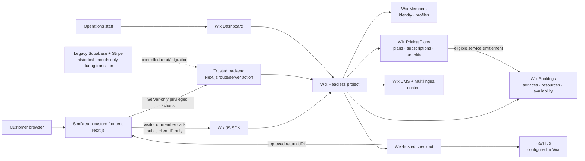
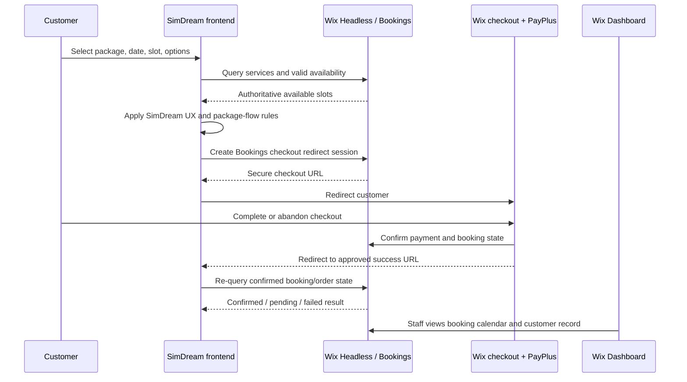
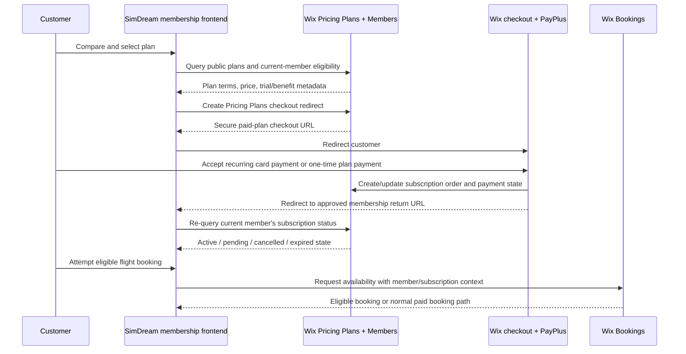

# Wix Headless Integration Architecture & DevOps Plan

**Status:** Proposed target architecture. No Wix integration, migration, credential, payment, or production-domain change is implemented by this document.

**Authority:** [`GENESIS.md`](../GENESIS.md) remains the canonical description of the currently running Next.js/Supabase/Stripe system. This document describes a deliberate future integration or migration path to Wix Headless.

## 1. Executive decision

SimDream should treat Wix Headless as a business platform, not as a replacement for the SimDream customer experience. The existing frontend owns the aviation product experience, multilingual UX, accessibility, package education, and custom scheduling presentation. Wix owns the business records and native operations that it is good at: Bookings, Members, checkout, payment-provider configuration, CMS content, notifications, and staff dashboards.

**Subscriptions are a separate commercial domain from one-off simulator bookings.** Wix Pricing Plans is the proposed authority for plan catalogue, recurring billing terms, trials, plan orders (called subscriptions by Wix), cancellation state, and plan-to-Booking benefits. The SimDream frontend renders the membership offer and member experience; it must not create a second recurring-billing system.

For the existing application, the safest first implementation is **self-managed Next.js frontend + Wix Headless business backend**:

- Keep the existing Next.js application and its tests intact.
- Connect the frontend to a dedicated Wix Headless project through the Wix JavaScript SDK.
- Move one bounded capability first: customer booking and checkout.
- Keep current Supabase/Stripe history read-only until there is an approved data-migration plan.
- Configure PayPlus inside Wix, never in browser code or in the Next.js repository.

Wix-managed hosting is a valid later choice. A Wix-managed Astro project receives the deepest integration, including automatic visitor/member authentication. A Wix-managed non-Astro frontend may be deployable when supported, but its authentication is still the application's responsibility. Do not rewrite the frontend merely to claim that the site is “on Wix.”

## 2. Current architecture to preserve

The production application is a TypeScript, Next.js App Router frontend with Tailwind CSS. It currently uses Supabase for persistence and member identity, Stripe Checkout plus a signed webhook for payment authority, SendGrid for confirmation delivery, and a deterministic scheduling engine.

The migration must preserve these non-negotiable behavioural rules:

| Area | Current invariant that must remain true |
| --- | --- |
| Guest checkout | A customer can book without creating an account. |
| Member ownership | Only a confirmed member identity may view that member's purchase history. Historical paid guest bookings may be linked only when the confirmed email exactly matches. |
| Payment state | A return to a success page is not proof of payment. A provider-confirmed booking/order is authoritative. |
| Scheduling | Reserved capacity is based on operating time, not only advertised flight duration. The 30/45/60/90/120-minute offers reserve 45/60/75/105/150 minutes respectively. |
| Package flows | Recreational bookings use the three-step experience; PRO and fear-of-flying flows omit consumer add-ons and use the two-step experience. |
| i18n | Hebrew, English, Russian, French, and Arabic remain supported. Hebrew and Arabic are RTL; aviation telemetry remains LTR. |
| Security | Prices, durations, discounts, availability, and confirmation state are server-authoritative. Production does not fall back to fake/in-memory orders. |

The current deterministic `kantorovich-engine.ts` is **not** a linear-programming implementation. It uses interval tiling, fixed reservation buffers, overlap checks, and dynamic programming. It must be reproduced or explicitly replaced—not silently approximated.

## 3. Target system architecture



### Responsibility boundary

| SimDream frontend | Wix Headless |
| --- | --- |
| Brand, design system, product storytelling, SEO implementation, language switcher, calendar presentation, zero-slot recovery UX | Bookings records, slot/resource administration, member identity, secure checkout page, payment-provider operation, CMS, staff operations |
| Package-specific UX and training/fear-of-flying noise suppression | Service catalogue, forms required for booking, cancellation/reschedule workflows, notifications |
| Custom scheduling proposal logic when native availability cannot express a rule | Final reservation and confirmed booking state |
| Monitoring of the custom application and its API boundary | Wix Dashboard operational view and Wix-native business records |

No browser component may receive a Wix API key, Wix client secret, PayPlus credential, webhook secret, or an unrestricted administrative token.

## 4. Deployment-path decision

### Option A — Self-managed Next.js frontend (recommended first)

The existing Next.js app remains the public frontend and is hosted on the existing deployment platform. Wix becomes its Headless business backend.

**Advantages**

- Preserves the current React/Next.js components and extensive quality suite.
- Avoids a risky simultaneous framework rewrite and business-platform migration.
- Lets the booking flow move incrementally while the public site remains operational.
- Keeps custom scheduling and RTL/i18n behaviour under the existing codebase's control.

**Engineering responsibilities**

- The application manages OAuth visitor/member session persistence.
- The application manages its own SEO, error monitoring, secret storage, and frontend deployment.
- A dedicated Headless client is configured with exact login callback URLs and allowed checkout-return domains.

### Option B — Wix-managed frontend using the existing framework

Wix can host supported pre-existing frontends. This reduces hosting operations, but a non-Astro app still needs its own authentication implementation and receives fewer platform integrations than Astro.

Before choosing this route, perform a framework/version preflight against Wix's current supported-framework list. Do not assume that a particular Next.js version can be uploaded or run merely because it builds locally.

### Option C — Full Wix-managed Astro rebuild

This is a controlled rewrite. Astro provides the richest Wix-managed experience, including managed authentication, secrets, SEO support, monitoring, and extension support. It is appropriate only after the team explicitly accepts the cost of re-implementing the existing frontend and regression suite.

## 5. Business-domain mapping

| SimDream domain | Recommended Wix native capability | Engineering note |
| --- | --- | --- |
| Simulator sessions | Wix Bookings services, resources/staff, availability | Model a simulator session as an appointment, not as an Event ticket. |
| Package duration and add-ons | Booking service options/variants where supported | Resolve prices and total operating time on the trusted side. Validate native capability fit before replacing the current calculator. |
| Flight-slot buffers | Wix Bookings configuration if it exactly supports the rule | Otherwise retain a trusted scheduling adapter that proposes only legal slots. Wix must remain the final reservation authority. |
| Customer identity | Wix Members | Guest purchase remains allowed; account creation/login is optional. |
| Checkout and payment | Wix-hosted Bookings checkout + PayPlus | Configure PayPlus in Wix. Do not add PayPlus credentials to frontend code. |
| Marketing, legal, FAQ, translated content | Wix CMS + Wix Multilingual | Establish a single publishing owner for each content field; do not maintain conflicting copies in code and CMS. |
| Corporate workshops | Wix Bookings or a separate structured workflow after discovery | Keep B2B CRM concerns separate from B2C simulator-session operations. |
| Gift vouchers | Wix native discount/promotion feature only if it satisfies partial-balance and expiry requirements | If it cannot reproduce the current voucher rules, keep a small audited server-side voucher domain instead of forcing an incorrect model. |
| Membership and subscriptions | Wix Pricing Plans + Wix Members + Wix Bookings | Wix Pricing Plans owns plan terms, recurring lifecycle, trials, and subscription state. Connect only approved Bookings services/benefits. |
| Operations admin | Wix Dashboard first | Build a custom dashboard only for capabilities absent from the native dashboard, such as SimDream-specific gap analysis. |

### Subscription product model

Pricing Plans should be used for recurring commercial commitments, not as a substitute for every package selector. A one-off 60-minute flight remains a normal Bookings checkout. A subscription becomes useful when the customer receives recurring membership value, such as priority booking, an ongoing member rate, a defined number of eligible sessions per cycle, training-program access, or members-only content.

| Subscription shape | Wix pricing model | Example SimDream use | Important design rule |
| --- | --- | --- | --- |
| Recurring membership | Recurring subscription | Monthly Flight Club membership, recurring PRO practice programme | Wix controls payment cycle, trial, renewal, cancellation, and subscription status. |
| Prepaid package | Single payment for a defined duration | Four sessions valid for 90 days | Use when the customer buys a finite package, not a recurring commitment. |
| Perpetual one-time entitlement | Single payment, unlimited duration | A permanent alumni-content entitlement | Rarely appropriate for simulator capacity; require explicit business approval. |
| Trial/community access | Free plan or free trial | One introductory benefit before paid membership | Enforce one-trial policy and define whether the benefit includes a flight, a discount, or content only. |

### Entitlements: decide before implementation

The word “subscription” is incomplete without a benefit contract. Before creating a plan, approve the answers to these questions:

1. Does the plan provide **access/discount**, **session credits**, or both?
2. Which Bookings services are eligible: recreational, PRO, fear-of-flying, workshops, or a subset?
3. How many sessions/minutes are included per billing cycle? Do unused credits roll over? When do they expire?
4. Can a plan be used in prime time, and is there a co-pay or supplement?
5. How do add-ons, gift vouchers, promotions, cancellations, no-shows, pauses, refunds, and failed renewals affect entitlement?
6. Is a customer required to be a Wix Member before purchase, or may a guest checkout create/claim membership during the flow?
7. Who can grant, revoke, or compensate a benefit, and what audit trail is required?

If native Pricing Plans + Bookings configuration expresses the approved benefit exactly, use it. If it does not—for example, a complicated rolling credit wallet—keep billing and subscription status in Wix Pricing Plans, then build only a narrow, trusted **entitlement adapter**. The adapter must be idempotent, keyed by the Wix member and subscription/order IDs, and must never independently charge, renew, or cancel a subscription.

## 6. Customer booking lifecycle



### Required success-page rule

The success route must never treat `?success=true`, a client-side redirect, or a payment-provider browser callback as confirmation. It must display a pending/failed state until Wix returns a confirmed booking/order through an authenticated, least-privilege query or trusted backend event.

### Guest and member flow

1. A visitor starts as an anonymous Wix visitor and may browse/select a session.
2. The visitor may check out without login if the Wix Booking/checkout configuration permits it.
3. A returning customer signs in with Wix Members.
4. The frontend queries only the current member's permitted booking/order history.
5. Any legacy guest-to-member linking is a deliberate server-side migration operation using exact, verified identity matching; it is never an anonymous “search by email” endpoint.

## 6A. Subscription lifecycle



### Subscription frontend responsibilities

- Render plan comparison, benefits, terms, trial disclosure, renewal frequency, and cancellation policy from an approved plan catalogue.
- Treat the post-checkout return as an instruction to **re-query** status, never as proof of activation.
- Show the current member their active plan, current billing/benefit period, included benefits, and the correct Wix-managed path for plan management/cancellation when applicable.
- Keep guest checkout for one-off simulator bookings. For subscriptions, the product team must explicitly choose the identity path because an ongoing entitlement and self-service cancellation require a reliably associated member identity.
- Do not calculate recurring renewal dates or payment state in the browser.

### Subscription backend responsibilities

- Treat Wix Pricing Plans' plan and subscription/order identifiers, status, cycle dates, and payment state as authoritative.
- Use the current member identity, not browser-supplied email, when deciding subscription eligibility.
- Resolve the active entitlement immediately before reserving a Bookings slot; a cached UI badge is never sufficient.
- Record immutable audit entries for manual entitlement adjustments, with actor, reason, source subscription/order ID, and expiry.
- Reconcile active subscriptions, cancelled subscriptions, failed renewals, and consumed benefits on a scheduled operational report.

## 7. Authentication and secret model

### Identities

| Identity | Where it runs | Allowed purpose |
| --- | --- | --- |
| Visitor | Browser SDK | Public catalogue, availability, own cart/session/checkout initiation. |
| Member | Browser SDK after Wix login | Current-member profile and that member's authorised history. |
| Application/service | Trusted backend only | Narrow operations requiring elevated access, audit logging, migration jobs, controlled reconciliation. |
| Wix administrator | Wix Dashboard | Human staff administration, roles, payment-provider configuration, native booking operations. |

### Credential rules

- A Wix **client ID** is public and may be exposed to the frontend.
- A Wix **client secret**, API key, PayPlus credentials, webhook secret, and any service credential are secret and must remain server-side or in the Wix/GitHub secret manager.
- Use a separate Headless client per independent frontend (for example, website and mobile app), and separate credentials per environment.
- Register exact login callback URLs and permitted redirect domains for local development, preview, staging, and production as each is introduced.
- Rotate any credential ever pasted into chat, source control, a terminal transcript, or a public issue.

## 8. Environment and DevOps design

### Environments

| Environment | Purpose | Wix project/data | Payment | Deployment rule |
| --- | --- | --- | --- | --- |
| Local | Developer iteration | Development or isolated test Wix project | No real charge | Local frontend, explicit test data only |
| Preview | Pull-request review | Staging Wix project with test data | Sandbox/test only | Automatically generated from pull request |
| Staging | End-to-end acceptance | Dedicated non-production Wix project | Sandbox/test only | Protected release candidate |
| Production | Customer traffic | Production Wix project | Live PayPlus only | Manual approval after staging acceptance |

Do not point a pull request or local laptop at production booking capacity or live payment credentials. A staging environment is not merely a different frontend URL: it must have separate operational test data and payment configuration.

### Subscription-payment prerequisites

Before enabling a recurring plan in production, validate all of the following in the Wix Dashboard and with the business/payment owner:

- Wix Pricing Plans is installed on both staging and production sites.
- The Wix site plan supports accepting online payments.
- PayPlus is connected to the correct environment and recurring card payments are enabled for the merchant account.
- The Wix site currency matches the configured PayPlus account currency.
- The selected recurring schedule, free trial, setup fee, cancellation policy, and customer-facing terms are approved.
- A non-production recurring-plan lifecycle has been tested: first charge, renewal simulation where available, cancellation, failed payment, benefit expiry, and member self-service visibility.

Wix documents that recurring Pricing Plans need a payment provider that supports recurring payments. It lists PayPlus as recurring-card capable, but provider activation, eligibility, commercial terms, and final acceptance remain an account-level configuration check. Pricing Plans cannot use manual/offline payment. Changing the payment provider later requires all active recurring plans to be cancelled and customers to repurchase, so provider changes require a formal migration runbook.

### Git strategy

```text
feature/*
  → pull request
  → static analysis + tests + preview deployment
  → staging UAT approval
  → protected main release
  → production deployment
```

Recommended branch protections for `main`:

- Require pull request review.
- Require passing type-check, unit, integration, accessibility, and browser checks.
- Block direct pushes and force pushes.
- Require manual production approval through a GitHub Environment.
- Record the deployed commit SHA in the release/change record.

### CI pipeline

1. Install dependencies from a locked package manager file.
2. Run `npm run lint` and `npm run typecheck`.
3. Run unit and integration tests, including scheduling, checkout-contract, and member-ownership tests.
4. Build the Next.js application.
5. Run a lightweight browser smoke test against a preview deployment and Wix staging.
6. Exercise a non-charging booking test: package → slot → checkout redirect creation → return-state verification.
7. Exercise a non-charging subscription test: plan display → pricing-plan checkout redirect → verified active/pending state → eligible benefit evaluation → cancellation/failure-path state.
8. Publish a deployment preview and attach its URL to the pull request.
9. After approval, promote the exact tested commit—not a rebuilt, unreviewed local directory.

For a Wix-managed frontend, the release step is: build with the framework's own tooling, then release the prepared output through the Wix CLI. For a self-managed frontend, the hosting platform performs the deploy step while Wix remains the business backend.

## 9. Data migration and cutover

### Migration principles

- Migrate data only after a written entity map, sample-data reconciliation, and backup.
- Never migrate card data. Payment processors retain payment instruments and payment-provider history.
- Preserve legacy booking references and a stable cross-system mapping table.
- Treat personal data as sensitive: export the minimum necessary, encrypt files at rest, limit access, and delete temporary exports after verified import.
- Do not write each new booking to both legacy and Wix systems indefinitely. Define one canonical writer before go-live.

### Suggested migration phases

1. **Discovery:** export only schema and aggregate counts; identify packages, bookings, vouchers, members, workshops, and receipt references.
2. **Mapping:** approve a field-by-field map and explicitly list fields that cannot migrate without a custom collection or retained legacy view.
3. **Staging import:** import representative non-production data, reconcile counts, and test permissions.
4. **Parallel verification:** run the Wix checkout flow in staging without changing the live Next.js checkout.
5. **Controlled cutover:** stop new legacy checkout creation, deploy the Wix-backed booking path, and retain legacy records read-only.
6. **Post-cutover reconciliation:** compare confirmed bookings, payment statuses, refunds/cancellations, and member access every day during the agreed observation period.

## 10. Quality, observability, and rollback

### Test matrix

- All five languages, including Hebrew and Arabic RTL layout and LTR telemetry.
- Recreational three-step booking with permitted add-ons.
- PRO and fear-of-flying two-step flow with no recreational add-ons.
- Sunday–Thursday, Friday, and Saturday operating windows.
- Fully booked package with visible zero-slot recovery actions.
- Guest checkout and optional member login.
- Authorised member can see only their own past/future bookings.
- Payment success, cancellation, expiry, and duplicated-callback/idempotency paths.
- PayPlus sandbox failure and recovery paths.
- Recurring-plan first charge, free-trial expiry, renewal, cancellation, payment failure, entitlement revocation, and no-double-credit paths.
- A member with an expired/cancelled subscription cannot consume a subscription-only booking benefit; a member with an active subscription can consume only the approved benefit.
- Mobile viewport, keyboard navigation, screen-reader alerts, and empty accessibility baseline.

### Operational signals

Alert on the following, with no personal data in logs:

- checkout redirect-session failures;
- booking confirmation that remains pending longer than an agreed threshold;
- availability/reservation conflicts;
- authentication callback failures;
- payment failure rate and webhook/event delivery failures;
- recurring-payment failures, cancellations, unexpectedly-expiring plans, and entitlement-reconciliation mismatches;
- elevated/admin API failures;
- frontend error rate, response latency, and broken multilingual routes.

### Rollback rule

Keep the prior frontend release artifact, the configuration version, and the exact migration/cutover record. A rollback switches customer traffic back to the last verified frontend path; it does **not** delete bookings or payment records. Reconcile any bookings created during an incident before re-opening sales.

## 11. Definition of done for the first production increment

The first increment is complete only when all of the following are true:

- A staging Wix project contains the approved Bookings and Members configuration.
- PayPlus is configured and verified with the appropriate non-production test flow.
- The Next.js booking page queries real staging services and availability.
- A guest can initiate checkout and receive an authoritative confirmed/pending result after return.
- A member can sign in and see only their own records.
- The staff can see the booking in Wix Dashboard.
- The current scheduling buffers, zero-slot recovery, package-flow rules, and five-language constraints have automated coverage.
- No secret is committed, logged, or exposed to the browser.
- Staging acceptance, rollback procedure, monitoring ownership, and production approval are documented.

### Additional definition of done for subscription launch

- Every live plan has approved customer-facing terms, benefits, duration, price, renewal schedule, cancellation policy, and owner.
- PayPlus recurring-card capability, Wix payment plan, and currency compatibility are confirmed for production.
- The active plan/subscription order is visible in Wix Dashboard and correctly associated with the intended member.
- The customer can see their current subscription status and the permitted plan-management/cancellation route.
- Booking eligibility is rechecked server-side immediately before reservation.
- The first production plan has been reviewed carefully before publication. Wix notes that Pricing Plans cannot currently be deleted; do not use production plans as experiments.
- A support runbook covers cancellation, refund/credit policy, failed renewals, manual benefit corrections, payment-provider migration, and reconciliation.

## 12. Official Wix references

- [Choose a Wix Headless development path](https://dev.wix.com/docs/go-headless/get-started/choose-your-development-path)
- [Add a frontend to an existing Wix site](https://dev.wix.com/docs/go-headless/self-managed-headless/get-started/add-a-frontend-to-an-existing-wix-site)
- [Wix Headless authentication](https://dev.wix.com/docs/go-headless/authentication/about-authentication)
- [Set up a Headless client](https://dev.wix.com/docs/go-headless/authentication/setup/set-up-a-headless-client)
- [Allowed redirect URIs and domains](https://dev.wix.com/docs/go-headless/authentication/setup/allow-redirect-uris-and-domains)
- [Wix Bookings Headless quick start](https://dev.wix.com/docs/go-headless/self-managed-headless/tutorials/java-script-sdk-tutorials/bookings-quick-start)
- [Wix Pricing Plans API and subscription models](https://dev.wix.com/docs/api-reference/business-solutions/pricing-plans/introduction?apiView=SDK)
- [Wix Plans V3 API](https://dev.wix.com/docs/api-reference/business-solutions/pricing-plans/plans-v3/introduction?apiView=SDK)
- [Wix hosted Pricing Plans checkout](https://dev.wix.com/docs/go-headless/business-solutions/wix-hosted-pages/about-wix-hosted-pages)
- [Wix recurring-payment support](https://support.wix.com/en/article/accepting-recurring-payments)
- [Wix PayPlus payment-provider setup (Hebrew)](https://support.wix.com/he/article/%D7%97%D7%99%D7%91%D7%95%D7%A8-payplus-%D7%9B%D7%A1%D7%A4%D7%A7-%D7%AA%D7%A9%D7%9C%D7%95%D7%9D)
- [Redirect to Wix-hosted checkout/login pages](https://dev.wix.com/docs/go-headless/business-solutions/wix-hosted-pages/redirect-using-the-js-sdk)
- [Deploy an existing frontend to Wix-managed Headless](https://dev.wix.com/docs/go-headless/wix-managed-headless/other-frameworks/your-own-frontend/deploy-your-own-frontend-with-the-cli)
